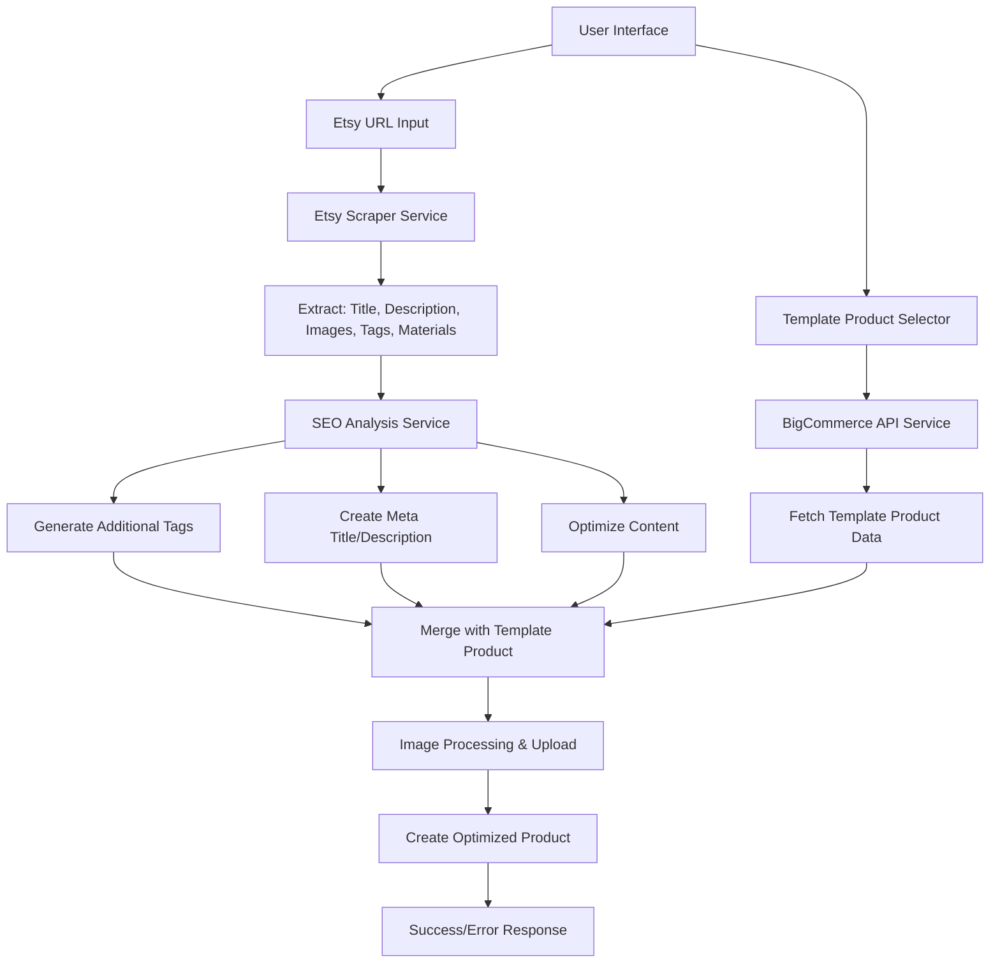

# Etsy-to-BigCommerce Import System with SEO Optimization

## Overview
A comprehensive system that imports Etsy listings into BigCommerce by duplicating existing product templates and replacing title, description, images, and tags with SEO-optimized content from Etsy listings.

## System Architecture



## Technical Components

### 1. Frontend Interface (`/app/etsy-import/page.tsx`)
- **Etsy URL Input**: Text field for Etsy listing URL with validation
- **Template Product Dropdown**: Searchable dropdown of all BigCommerce products
- **SEO Preview Section**: 
  - Tag cloud visualization
  - Meta title/description preview
  - Keyword density analysis
  - SEO score display
- **Customization Options**:
  - Tag editor (add/remove/edit tags)
  - Meta editor (customize title/description)
  - Keyword suggestions
- **Import Button**: Execute the import process
- **Status Display**: Real-time progress and results

### 2. Etsy Scraping Service (`/lib/etsy/scraper.ts`)
```typescript
interface EtsyProductData {
  title: string
  description: string
  images: string[]
  tags: string[]
  materials: string[]
  category: string
  attributes: Record<string, string>
  price?: number
  shop: string
}

interface EtsyScrapingResult {
  success: boolean
  data?: EtsyProductData
  error?: string
}
```

**Features**:
- URL validation for Etsy listings
- Web scraping using Puppeteer for dynamic content
- Extract product data including hidden tags and materials
- Handle anti-bot measures with user agent rotation
- Error handling for blocked requests

### 3. SEO Optimization Services

#### A. Tag Processor (`/lib/seo/tag-processor.ts`)
```typescript
interface TagProcessingOptions {
  maxTags: number
  includeEtsyTags: boolean
  generateKeywords: boolean
  categoryTags: boolean
  brandTags: boolean
}

interface ProcessedTags {
  originalTags: string[]
  generatedTags: string[]
  finalTags: string[]
  removedTags: string[]
}
```

#### B. Content Generator (`/lib/seo/content-generator.ts`)
```typescript
interface SEOContent {
  metaTitle: string         // Optimized title (60 chars max)
  metaDescription: string   // Compelling description (160 chars max)
  urlSlug: string          // SEO-friendly URL
  enhancedDescription: string // Keyword-optimized description
  imageAltTexts: string[]   // Alt text for each image
  searchKeywords: string    // Comma-separated keywords
}
```

#### C. Keyword Analyzer (`/lib/seo/keyword-analyzer.ts`)
```typescript
interface KeywordAnalysis {
  primaryKeywords: string[]
  secondaryKeywords: string[]
  longTailKeywords: string[]
  keywordDensity: Record<string, number>
  suggestions: string[]
}
```

### 4. Image Processing Service (`/lib/etsy/image-processor.ts`)
```typescript
interface ImageProcessingResult {
  success: boolean
  bigcommerceImageId?: number
  url?: string
  altText: string
  error?: string
}
```

**Features**:
- Download high-resolution images from Etsy
- Upload to BigCommerce via API
- Generate SEO-optimized alt text
- Handle multiple image formats
- Error recovery for failed downloads

### 5. Product Duplication Service (`/lib/bigcommerce/product-duplicator.ts`)
```typescript
interface DuplicationOptions {
  templateProductId: number
  etsyData: EtsyProductData
  seoContent: SEOContent
  processedTags: ProcessedTags
  preserveFields: string[]
}

interface OptimizedProduct {
  // Core fields (replaced)
  name: string
  description: string
  images: Array<{
    url: string
    alt_text: string
    description: string
  }>
  
  // SEO fields (new/updated)
  meta_title: string
  meta_description: string
  search_keywords: string
  page_title: string
  custom_url: {
    url: string
    is_customized: boolean
  }
  
  // Tags
  tags: string[]
  
  // Preserved from template
  price: number
  sku: string
  categories: number[]
  modifiers: any[]
  inventory_tracking: string
  // ... all other template fields
}
```

### 6. API Endpoints

#### A. `/api/etsy/scrape` (POST)
```typescript
interface ScrapeRequest {
  url: string
  options?: {
    includeImages: boolean
    includeTags: boolean
    includeMaterials: boolean
  }
}

interface ScrapeResponse {
  success: boolean
  data?: EtsyProductData
  seoAnalysis?: KeywordAnalysis
  error?: string
}
```

#### B. `/api/etsy/import` (POST)
```typescript
interface ImportRequest {
  etsyUrl: string
  templateProductId: number
  seoOptions: {
    generateTags: boolean
    optimizeContent: boolean
    customTags?: string[]
    customMetaTitle?: string
    customMetaDescription?: string
  }
}

interface ImportResponse {
  success: boolean
  productId?: number
  productUrl?: string
  seoReport?: {
    tagsAdded: number
    keywordsOptimized: number
    metaGenerated: boolean
  }
  error?: string
}
```

#### C. `/api/bigcommerce/products/templates` (GET)
```typescript
interface TemplateProduct {
  id: number
  name: string
  sku: string
  price: number
  categories: string[]
  hasModifiers: boolean
  imageCount: number
}

interface TemplatesResponse {
  success: boolean
  products: TemplateProduct[]
  total: number
}
```

## Implementation Phases

### Phase 1: Core Infrastructure
1. **Install dependencies**:
   ```bash
   npm install puppeteer cheerio natural keyword-extractor
   npm install @types/puppeteer
   ```

2. **Create Etsy scraping service**:
   - URL validation and parsing
   - Puppeteer setup with stealth mode
   - Data extraction logic
   - Error handling and retries

3. **Build SEO services**:
   - Keyword extraction and analysis
   - Tag generation algorithms
   - Meta content optimization
   - Content enhancement logic

### Phase 2: BigCommerce Integration
1. **Product duplication logic**:
   - Fetch template product with all relationships
   - Preserve modifiers, categories, pricing, inventory
   - Replace only specified fields

2. **Image processing pipeline**:
   - Download and optimize images
   - Upload to BigCommerce
   - Generate alt text and descriptions

3. **API endpoint development**:
   - Scraping endpoint with progress tracking
   - Import endpoint with detailed reporting
   - Template selection with filtering

### Phase 3: User Interface
1. **Import page creation**:
   - Clean, intuitive interface
   - Real-time progress indicators
   - SEO preview and editing tools

2. **Advanced features**:
   - Batch import capability
   - Import history and tracking
   - SEO performance analytics

## File Structure
```
app/
├── etsy-import/
│   └── page.tsx                 # Main import interface
├── api/
│   ├── etsy/
│   │   ├── scrape/route.ts      # Etsy data extraction
│   │   └── import/route.ts      # Complete import process
│   └── bigcommerce/
│       └── products/
│           └── templates/route.ts # Template selection

lib/
├── etsy/
│   ├── scraper.ts               # Web scraping logic
│   ├── image-processor.ts       # Image handling
│   └── data-mapper.ts           # Data transformation
├── seo/
│   ├── optimizer.ts             # Main SEO optimization
│   ├── tag-processor.ts         # Tag generation and processing
│   ├── content-generator.ts     # SEO content creation
│   ├── keyword-analyzer.ts      # Keyword analysis
│   └── meta-generator.ts        # Meta title/description
└── bigcommerce/
    └── product-duplicator.ts    # Product duplication logic

components/
├── etsy-import/
│   ├── url-input.tsx           # Etsy URL input component
│   ├── template-selector.tsx   # Product template selector
│   ├── seo-preview.tsx         # SEO optimization preview
│   ├── tag-editor.tsx          # Tag editing interface
│   └── import-progress.tsx     # Progress tracking
```

## SEO Optimization Features

### 1. Tag System
- **Extract Etsy tags**: Original listing tags
- **Generate keyword tags**: From title and description analysis
- **Category tags**: Based on product category
- **Brand/material tags**: From product attributes
- **Long-tail keywords**: For specific search terms
- **Competitive tags**: Industry-relevant keywords

### 2. Meta Optimization
- **Meta title**: Keyword-rich, under 60 characters
- **Meta description**: Compelling, under 160 characters
- **URL slug**: SEO-friendly, keyword-based
- **Page title**: Optimized for search engines

### 3. Content Enhancement
- **Keyword integration**: Natural keyword placement
- **Readability optimization**: Improved content structure
- **Search term density**: Optimal keyword frequency
- **Content length**: Appropriate description length

### 4. Image SEO
- **Alt text generation**: Descriptive, keyword-rich
- **Image descriptions**: Detailed image context
- **File name optimization**: SEO-friendly image names

## Technical Considerations

### Web Scraping
- **Anti-bot evasion**: Rotating user agents, random delays
- **Dynamic content**: Handle JavaScript-rendered elements
- **Rate limiting**: Respect Etsy's rate limits
- **Error recovery**: Graceful handling of failures

### Performance
- **Async processing**: Non-blocking operations
- **Progress tracking**: Real-time status updates
- **Caching**: Cache template products and categories
- **Batch operations**: Efficient API usage

### Security & Compliance
- **Rate limiting**: Prevent abuse
- **Input validation**: Sanitize all inputs
- **Error handling**: Secure error messages
- **Data privacy**: Handle scraped data responsibly

## Success Metrics
- **Import success rate**: Percentage of successful imports
- **SEO improvement**: Before/after SEO scores
- **Tag relevance**: Quality of generated tags
- **Content optimization**: Keyword density and readability
- **User satisfaction**: Ease of use and results quality

This comprehensive system will provide a powerful tool for importing Etsy listings with full SEO optimization, ensuring maximum search visibility and discoverability for imported products.