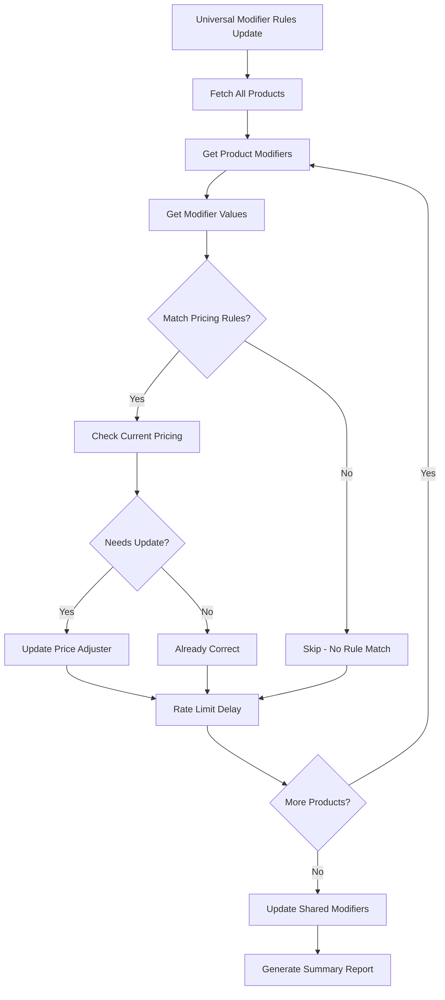

# Universal Modifier Rules Update System Plan

## Overview
Create a system to update **ALL products' modifier pricing rules** regardless of their current state, while respecting BigCommerce API call limits.

## Current System Analysis

### Existing Pricing Rules System
You have a working pricing rules system in [`app/api/bigcommerce/catalog/update-pricing-rules/route.ts`](app/api/bigcommerce/catalog/update-pricing-rules/route.ts) with:

```typescript
const MODIFIER_PRICE_RULES = {
  "Shirt Size": {
    "2X-Large": 4.00,
    "3X-Large": 6.00
  },
  "Shirt Style": {
    "Women Vneck": 2.00,
    "Women Tanktop": 2.00,
    "Women Long Sleeve": 6.00,
    "Unisex Long Sleeve": 6.00,
    "Unisex Sweatshirts": 6.00,
    "Unisex Hoodie": 10.00
  }
}
```

### Shared Modifiers System
You also have shared modifiers functionality:
- Fetches shared modifiers from BigCommerce catalog
- Applies shared modifiers to multiple products
- Handles both v2 and v3 API endpoints

## Enhanced Universal Rules Update Requirements

### Core Functionality
1. **Universal Coverage**: Update pricing rules on ALL products' modifiers
2. **Rule Application**: Apply pricing adjusters whether modifiers currently have them or not
3. **Shared + Individual**: Handle both shared modifiers and individual product modifiers
4. **API-Safe**: Respect BigCommerce rate limits

### Current Limitation
Your existing pricing rules system only updates modifiers that **match the naming patterns**. We need to enhance it to:
- **Force update ALL matching modifiers** regardless of current pricing state
- **Handle products that don't have pricing rules yet**
- **Update shared modifiers** that are applied to multiple products
- **Batch process** with better rate limiting

## Enhanced System Architecture



## Implementation Plan

### Phase 1: Enhanced Pricing Rules API
**File**: `/app/api/bigcommerce/modifiers/universal-pricing-update/route.ts`

#### Enhanced Features
1. **Force Update Mode**: Update ALL matching modifiers regardless of current state
2. **Shared Modifier Support**: Update shared modifiers that affect multiple products
3. **Better Rate Limiting**: Use your proven rate limiting strategy
4. **Comprehensive Reporting**: Detailed success/failure tracking

#### Enhanced Rate Limiting
```typescript
const RATE_LIMITS = {
  DELAY_BETWEEN_CALLS: 1000,    // 1 second (proven to work)
  BATCH_SIZE: 10,               // 10 products per batch
  BATCH_DELAY: 5000,            // 5 seconds between batches
  MAX_RETRIES: 3                // Retry failed operations
}
```

### Phase 2: Enhanced Pricing Rules Logic

#### Current vs Enhanced Approach

**Current System** (works but limited):
```typescript
// Only updates if price is different
if (currentAdjuster !== priceAdjustment) {
  // Update price adjuster
}
```

**Enhanced System** (force update all):
```typescript
// Force update ALL matching modifiers
const priceAdjustment = getPriceAdjuster(modifier.display_name, value.label)
if (priceAdjustment !== null) {
  // ALWAYS update, regardless of current state
  await updateModifierValue(product.id, modifier.id, value.id, {
    ...value,
    adjusters: {
      price: {
        adjuster: "relative",
        adjuster_value: priceAdjustment
      }
    }
  })
}
```

### Phase 3: Shared Modifiers Integration

#### Process Flow
1. **Update Individual Product Modifiers** (existing logic)
2. **Identify Shared Modifiers** that need pricing rules
3. **Update Shared Modifiers** at the catalog level
4. **Re-apply Shared Modifiers** to products if needed

#### Shared Modifier Update Logic
```typescript
// Get all shared modifiers
const sharedModifiers = await getSharedModifiers()

// Update pricing rules on shared modifiers
for (const sharedModifier of sharedModifiers) {
  if (matchesPricingRules(sharedModifier.display_name)) {
    await updateSharedModifierPricing(sharedModifier.id, pricingRules)
  }
}
```

### Phase 4: Enhanced API Endpoint Structure

#### GET Endpoint - Analysis
```typescript
interface PricingAnalysisResponse {
  totalProducts: number
  productsWithModifiers: number
  modifiersNeedingPricing: {
    productId: number
    productName: string
    modifiers: {
      modifierId: number
      modifierName: string
      values: {
        valueId: number
        valueLabel: string
        currentPrice: number | null
        targetPrice: number
        needsUpdate: boolean
      }[]
    }[]
  }[]
  sharedModifiers: {
    id: number
    name: string
    needsPricingUpdate: boolean
  }[]
  estimatedApiCalls: number
  estimatedTime: string
}
```

#### POST Endpoint - Universal Update
```typescript
interface PricingUpdateRequest {
  forceUpdate: boolean          // Update ALL regardless of current state
  includeSharedModifiers: boolean
  targetProducts?: number[]     // Optional: specific products
  rateLimitPlan: 'basic' | 'plus' | 'enterprise'
  dryRun: boolean              // Preview changes without applying
}
```

### Phase 5: Enhanced UI Interface
**File**: `/app/modifiers/universal-pricing-update/page.tsx`

#### Features
- **Pricing Analysis Dashboard**: Show current pricing state across catalog
- **Force Update Option**: Update all modifiers regardless of current state
- **Shared Modifiers Management**: Handle shared modifiers separately
- **Progress Tracking**: Real-time progress with detailed logging
- **Dry Run Mode**: Preview changes before applying

### Phase 6: Enhanced Pricing Rules Configuration

#### Expanded Rules Structure
```typescript
const ENHANCED_MODIFIER_PRICE_RULES = {
  "Shirt Size": {
    rules: {
      "2X-Large": 4.00,
      "3X-Large": 6.00
    },
    applyToShared: true,
    forceUpdate: true
  },
  "Shirt Style": {
    rules: {
      "Women Vneck": 2.00,
      "Women Tanktop": 2.00,
      "Women Long Sleeve": 6.00,
      "Unisex Long Sleeve": 6.00,
      "Unisex Sweatshirts": 6.00,
      "Unisex Hoodie": 10.00
    },
    applyToShared: true,
    forceUpdate: true
  }
}
```

## API Call Estimation

### For 1700 Products with Modifiers
- **Product Scan**: ~1700 calls (get products)
- **Modifier Check**: ~1700 calls (get modifiers per product)
- **Value Updates**: ~10,200 calls (avg 6 modifier values per product)
- **Shared Modifier Updates**: ~50 calls (update shared modifiers)
- **Total**: ~13,650 API calls

### Time Estimation (Basic Plan)
- **Rate**: 1 call per second + batch delays
- **Estimated Time**: ~4-5 hours for complete catalog update
- **Batch Processing**: 10 products every 15 seconds

## Enhanced Features

### 1. Force Update Mode
- Updates ALL matching modifiers regardless of current pricing state
- Ensures consistency across entire catalog
- Handles products that were missed in previous updates

### 2. Shared Modifiers Support
- Identifies and updates shared modifiers at catalog level
- Applies pricing rules to shared modifiers
- Handles products using shared modifiers

### 3. Better Error Handling
- Detailed error tracking for each modifier value
- Automatic retry logic for failed operations
- Resume capability for interrupted operations

### 4. Comprehensive Reporting
- Before/after pricing comparison
- Success/failure rates per modifier type
- Detailed logs for troubleshooting

## Benefits

1. **Complete Coverage**: Updates ALL products regardless of current pricing state
2. **Shared Modifier Support**: Handles both individual and shared modifiers
3. **API-Safe**: Uses proven rate limiting strategy
4. **Force Update**: Ensures consistency across entire catalog
5. **Comprehensive**: Handles edge cases and error scenarios
6. **Resumable**: Can continue interrupted operations

## Risk Mitigation

1. **API Limits**: Conservative rate limiting with proven delays
2. **Data Integrity**: Dry-run mode for testing before applying
3. **Partial Failures**: Detailed tracking and retry mechanisms
4. **Large Operations**: Batch processing with progress checkpoints

## Next Steps

1. **Enhance existing pricing rules API** with force update capability
2. **Add shared modifiers support** to pricing rules system
3. **Create enhanced UI interface** with force update options
4. **Test with small batch** before full catalog update
5. **Monitor and optimize** based on real-world performance

This enhanced system will ensure ALL your products have consistent pricing rules applied to their modifiers, whether they're individual product modifiers or shared modifiers used across multiple products.