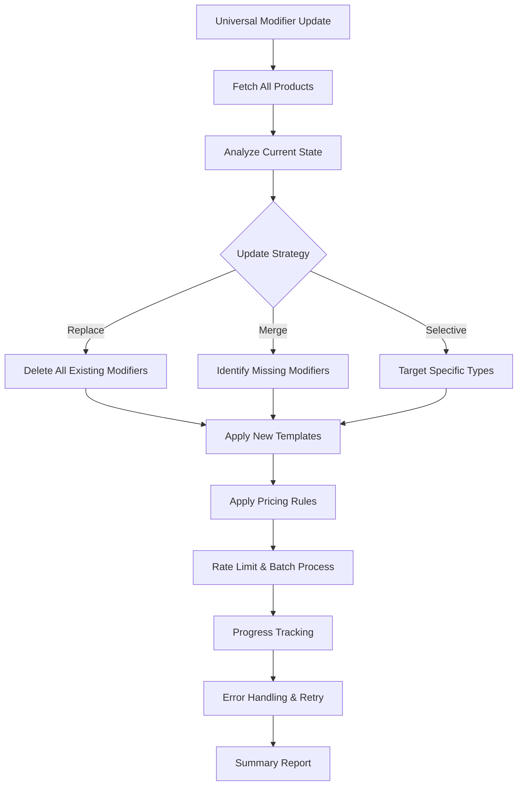

# Universal Modifier Update System Plan

## Overview
Create a system to update **ALL** products' modifier rules regardless of their current state, while respecting BigCommerce API call limits.

## Current System Analysis

### Existing Modifier Templates (from Product 6013)
1. **Shirt Size** (Dropdown)
   - Small, Medium, Large, X-Large, 2X-Large (+$4.00), 3X-Large (+$6.00)

2. **Shirt Style** (Dropdown)
   - Women Vneck (+$2.00), Women Tanktop (+$2.00)
   - Women Long Sleeve (+$6.00), Unisex Long Sleeve (+$6.00)
   - Unisex Sweatshirts (+$6.00), Unisex Hoodie (+$10.00)

3. **Personalization** (Text Field)
   - Custom text input for personalization

### Current Rate Limiting (Working Well)
- **1 second delay** between API calls
- **Batch processing**: 10 products at a time
- **5 second delay** between batches
- Handles 1700+ products efficiently

## Enhanced System Requirements

### Core Functionality
1. **Universal Update**: Update ALL products regardless of current modifier state
2. **Strategy Options**:
   - **Replace Mode**: Delete existing modifiers → Apply new templates
   - **Merge Mode**: Keep existing → Add missing templates
   - **Selective Mode**: Update specific modifier types only

### API Operations Required
1. **GET** all products (with pagination)
2. **GET** current modifiers for each product
3. **DELETE** existing modifiers (if replace mode)
4. **POST** new modifiers to products
5. **PUT** update modifier values with pricing rules

## System Architecture



## Implementation Plan

### Phase 1: Enhanced API Endpoint
**File**: `/app/api/bigcommerce/modifiers/universal-update/route.ts`

#### GET Endpoint - Analysis
```typescript
interface AnalysisResponse {
  totalProducts: number
  productsWithModifiers: {
    id: number
    name: string
    modifiers: ModifierInfo[]
  }[]
  productsWithoutModifiers: {
    id: number
    name: string
  }[]
  modifierTemplates: ModifierTemplate[]
  estimatedApiCalls: number
  estimatedTime: string
}
```

#### POST Endpoint - Universal Update
```typescript
interface UpdateRequest {
  strategy: 'replace' | 'merge' | 'selective'
  modifierTemplates: ModifierTemplate[]
  targetProducts?: number[] // Optional: specific products
  rateLimitPlan: 'basic' | 'plus' | 'enterprise'
  applyPricingRules: boolean
}
```

### Phase 2: Modifier Template Definitions
**Standard Templates** (from Product 6013):

```typescript
const STANDARD_MODIFIER_TEMPLATES = [
  {
    display_name: "Shirt Size",
    type: "dropdown",
    required: false,
    option_values: [
      { label: "Small", sort_order: 0, is_default: true },
      { label: "Medium", sort_order: 1 },
      { label: "Large", sort_order: 2 },
      { label: "X-Large", sort_order: 3 },
      { 
        label: "2X-Large", 
        sort_order: 4,
        adjusters: {
          price: { adjuster: "relative", adjuster_value: 4.00 }
        }
      },
      { 
        label: "3X-Large", 
        sort_order: 5,
        adjusters: {
          price: { adjuster: "relative", adjuster_value: 6.00 }
        }
      }
    ]
  },
  {
    display_name: "Shirt Style",
    type: "dropdown",
    required: false,
    option_values: [
      { label: "Unisex Tshirt", sort_order: 0, is_default: true },
      { 
        label: "Women Vneck", 
        sort_order: 1,
        adjusters: {
          price: { adjuster: "relative", adjuster_value: 2.00 }
        }
      },
      { 
        label: "Women Tanktop", 
        sort_order: 2,
        adjusters: {
          price: { adjuster: "relative", adjuster_value: 2.00 }
        }
      },
      { 
        label: "Women Long Sleeve", 
        sort_order: 3,
        adjusters: {
          price: { adjuster: "relative", adjuster_value: 6.00 }
        }
      },
      { 
        label: "Unisex Long Sleeve", 
        sort_order: 4,
        adjusters: {
          price: { adjuster: "relative", adjuster_value: 6.00 }
        }
      },
      { 
        label: "Unisex Sweatshirts", 
        sort_order: 5,
        adjusters: {
          price: { adjuster: "relative", adjuster_value: 6.00 }
        }
      },
      { 
        label: "Unisex Hoodie", 
        sort_order: 6,
        adjusters: {
          price: { adjuster: "relative", adjuster_value: 10.00 }
        }
      }
    ]
  },
  {
    display_name: "Personalization",
    type: "text",
    required: false,
    config: {
      text_max_length: 100,
      text_min_length: 0
    }
  }
]
```

### Phase 3: Enhanced Rate Limiting Strategy

```typescript
const RATE_LIMIT_CONFIGS = {
  basic: {
    delayBetweenCalls: 1000,    // 1 second
    batchSize: 10,              // 10 products per batch
    batchDelay: 5000,           // 5 seconds between batches
    maxRetries: 3
  },
  plus: {
    delayBetweenCalls: 500,     // 0.5 seconds
    batchSize: 20,              // 20 products per batch
    batchDelay: 2000,           // 2 seconds between batches
    maxRetries: 3
  },
  enterprise: {
    delayBetweenCalls: 200,     // 0.2 seconds
    batchSize: 50,              // 50 products per batch
    batchDelay: 1000,           // 1 second between batches
    maxRetries: 5
  }
}
```

### Phase 4: Update Process Logic

#### Replace Mode Process
1. **Scan**: Get all products and their current modifiers
2. **Delete**: Remove all existing modifiers from each product
3. **Apply**: Add new modifier templates
4. **Price**: Apply pricing rules to modifier values

#### Merge Mode Process
1. **Scan**: Get all products and their current modifiers
2. **Compare**: Identify missing modifier templates
3. **Add**: Apply only missing templates
4. **Update**: Ensure pricing rules are applied

#### Selective Mode Process
1. **Scan**: Get all products and their current modifiers
2. **Filter**: Target specific modifier types (e.g., only "Shirt Size")
3. **Replace**: Update only selected modifier types
4. **Preserve**: Keep other modifiers unchanged

### Phase 5: Enhanced UI Interface
**File**: `/app/modifiers/universal-update/page.tsx`

#### Features
- **Analysis Dashboard**: Show current modifier state across catalog
- **Strategy Selection**: Choose update approach (Replace/Merge/Selective)
- **Template Management**: Select which templates to apply
- **Progress Tracking**: Real-time progress with detailed logging
- **Error Management**: Detailed error reporting and retry options
- **Backup & Rollback**: Save current state before updates

### Phase 6: Safety & Recovery Features

#### Backup System
- Save current modifier state before updates
- Export backup data as JSON
- Rollback capability to restore previous state

#### Error Handling
- Detailed error logging for each product
- Automatic retry logic for failed operations
- Partial success handling (some products succeed, others fail)
- Resume capability for interrupted operations

#### Validation
- Dry-run mode to preview changes
- Template validation before application
- Product eligibility checks

## API Call Estimation

### For 1700 Products (Basic Plan)
- **Analysis Phase**: ~1700 calls (get modifiers for each product)
- **Delete Phase**: ~5100 calls (avg 3 modifiers per product)
- **Apply Phase**: ~5100 calls (3 new modifiers per product)
- **Total**: ~11,900 API calls

### Time Estimation (Basic Plan)
- **Rate**: 1 call per second + batch delays
- **Estimated Time**: ~4-5 hours for complete catalog update
- **Batch Processing**: 10 products every 15 seconds (10 calls + 5s delay)

## Benefits

1. **Complete Control**: Update ALL products regardless of current state
2. **Flexible Strategies**: Choose how to handle existing modifiers
3. **API-Safe**: Respects all BigCommerce rate limits
4. **Scalable**: Handles large catalogs efficiently
5. **Recoverable**: Backup and rollback capabilities
6. **Transparent**: Detailed progress and error reporting
7. **Resumable**: Can continue interrupted operations

## Risk Mitigation

1. **API Limits**: Conservative rate limiting with plan-specific configs
2. **Data Loss**: Comprehensive backup before any changes
3. **Partial Failures**: Detailed tracking and retry mechanisms
4. **Large Operations**: Batch processing with progress checkpoints
5. **System Interruption**: Resume capability for long-running operations

## Next Steps

1. **Create Universal Update API** with enhanced logic
2. **Build Enhanced UI Interface** with strategy selection
3. **Implement Safety Features** (backup, rollback, validation)
4. **Test with Small Batch** before full catalog update
5. **Monitor and Optimize** based on real-world performance

This system will provide complete control over your modifier management while ensuring safe, efficient operations within BigCommerce API limits.