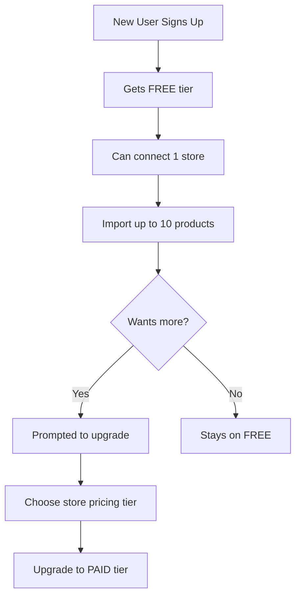
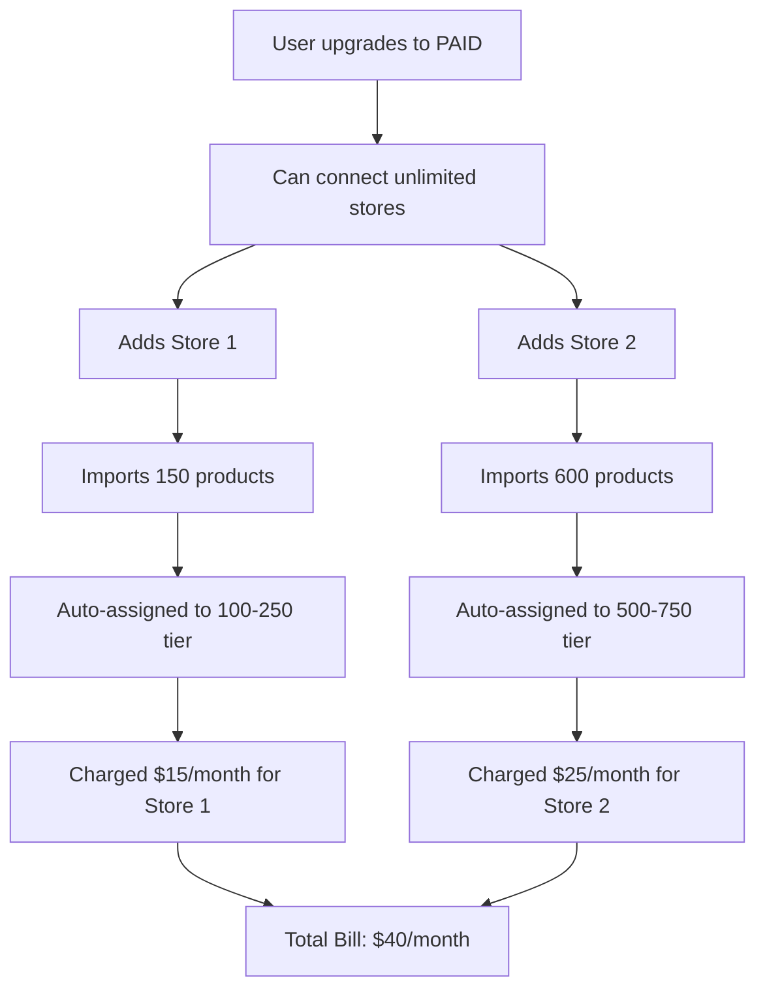

# Per-Store Pricing Model - TEKMS Listing Manager

## Approved Pricing Structure ✅

### Free Tier
- **1 store connection** maximum
- **10 products** total across that store
- All platforms available (with OAuth)

### Paid Tiers (Per-Store Billing)
Users can connect **unlimited stores**, but each store is billed separately based on its product count:

| Product Range | Price per Store/Month | Stripe Price ID |
|---------------|----------------------|-----------------|
| 10-100        | $10                  | (admin sets)    |
| 100-250       | $15                  | (admin sets)    |
| 250-500       | $20                  | (admin sets)    |
| 500-750       | $25                  | (admin sets)    |
| 750-1000      | $30                  | (admin sets)    |
| 1000-1500     | $50                  | (admin sets)    |
| 1500+         | Contact Us           | Enterprise      |

**Admin can modify these ranges and prices dynamically**

---

## Updated Database Schema

### New: Store-Based Subscription Model

```prisma
// User still has ONE subscription record for account status
model Subscription {
  id                     String             @id @default(cuid())
  userId                 String             @unique
  stripeCustomerId       String?            @unique
  tier                   SubscriptionTier   @default(FREE)
  status                 SubscriptionStatus @default(ACTIVE)
  
  user User @relation(fields: [userId], references: [id], onDelete: Cascade)
  
  createdAt DateTime @default(now())
  updatedAt DateTime @updatedAt
  
  @@index([userId])
  @@index([stripeCustomerId])
}

enum SubscriptionTier {
  FREE      // 1 store, 10 products
  PAID      // Unlimited stores, per-store billing
  ENTERPRISE // Custom pricing, contact sales
}

// NEW: Per-Store Subscription
model StoreSubscription {
  id                     String   @id @default(cuid())
  storeConnectionId      String   @unique
  userId                 String   // Denormalized for queries
  
  // Stripe details
  stripeSubscriptionId   String?  @unique
  stripePriceId          String?
  stripeCurrentPeriodEnd DateTime?
  
  // Current pricing tier for this store
  pricingTierId          String
  productCount           Int      @default(0)
  
  // Status
  status                 SubscriptionStatus @default(ACTIVE)
  cancelAtPeriodEnd      Boolean  @default(false)
  
  // Relations
  storeConnection StoreConnection @relation(fields: [storeConnectionId], references: [id], onDelete: Cascade)
  pricingTier     StorePricingTier @relation(fields: [pricingTierId], references: [id])
  
  createdAt DateTime @default(now())
  updatedAt DateTime @updatedAt
  
  @@index([userId])
  @@index([storeConnectionId])
  @@index([stripeSubscriptionId])
}

// NEW: Admin-Manageable Store Pricing Tiers
model StorePricingTier {
  id              String   @id @default(cuid())
  name            String   // "Starter", "Growth", "Pro", etc.
  
  // Product range
  minProducts     Int      // e.g., 10
  maxProducts     Int      // e.g., 100 (-1 for unlimited)
  
  // Pricing
  monthlyPrice    Decimal  @db.Decimal(10, 2)
  yearlyPrice     Decimal? @db.Decimal(10, 2)
  stripePriceId   String?  // Stripe monthly price ID
  stripeYearlyPriceId String?
  
  // Features
  features        Json     // Array of feature strings
  
  // Display
  isActive        Boolean  @default(true)
  displayOrder    Int      @default(0)
  description     String?
  
  // Relations
  storeSubscriptions StoreSubscription[]
  
  createdAt DateTime @default(now())
  updatedAt DateTime @updatedAt
  
  @@index([isActive, displayOrder])
  @@index([minProducts, maxProducts])
}

// Update StoreConnection
model StoreConnection {
  id                String   @id @default(cuid())
  userId            String
  platform          Platform
  
  // Store Info
  storeName         String
  storeUrl          String?
  externalStoreId   String
  
  // OAuth Tokens (encrypted)
  accessToken       String   @db.Text
  refreshToken      String?  @db.Text
  tokenExpiresAt    DateTime?
  scopes            String[]
  
  // Status
  isActive          Boolean  @default(true)
  lastSyncedAt      DateTime?
  syncStatus        String?
  syncError         String?
  
  // Product tracking
  productCount      Int      @default(0) // Cache of current product count
  
  // Metadata
  metadata          Json?
  
  user               User               @relation(fields: [userId], references: [id], onDelete: Cascade)
  products           Product[]
  storeSubscription  StoreSubscription? // NEW: Link to subscription
  
  createdAt DateTime @default(now())
  updatedAt DateTime @updatedAt
  
  @@unique([userId, platform, externalStoreId])
  @@index([userId, platform])
  @@index([userId, isActive])
}
```

---

## How Billing Works

### Free User Flow



### Paid User Flow



### Billing Calculation

**User Total Monthly Bill = Base Fee + Sum of All Store Subscriptions**

Example:
- User has PAID tier (no base fee, or $0/month)
- Store 1: 150 products → $15/month
- Store 2: 600 products → $25/month
- Store 3: 50 products → $10/month
- **Total: $50/month**

---

## Store Subscription Lifecycle

### 1. Connect New Store

```typescript
async function connectStore(userId: string, platform: Platform, authData: any) {
  // 1. Create StoreConnection
  const store = await db.storeConnection.create({
    data: {
      userId,
      platform,
      storeName: authData.shopName,
      accessToken: encryptedToken,
      // ...
    }
  })
  
  // 2. Check user tier
  const user = await db.user.findUnique({
    where: { id: userId },
    include: { subscription: true }
  })
  
  if (user.subscription.tier === 'FREE') {
    // Free users don't get store subscriptions yet (only 10 products total)
    return store
  }
  
  // 3. For PAID users, create StoreSubscription
  const defaultTier = await getLowestPricingTier() // 10-100 products tier
  
  const storeSubscription = await db.storeSubscription.create({
    data: {
      storeConnectionId: store.id,
      userId: userId,
      pricingTierId: defaultTier.id,
      productCount: 0,
      status: 'ACTIVE'
    }
  })
  
  // 4. Create Stripe subscription
  const stripeSubscription = await stripe.subscriptions.create({
    customer: user.subscription.stripeCustomerId,
    items: [{ price: defaultTier.stripePriceId }],
    metadata: {
      storeConnectionId: store.id,
      userId: userId,
      platform: platform
    }
  })
  
  await db.storeSubscription.update({
    where: { id: storeSubscription.id },
    data: { stripeSubscriptionId: stripeSubscription.id }
  })
  
  return store
}
```

### 2. Import Products (Check Limits & Auto-Upgrade)

```typescript
async function importProducts(storeConnectionId: string, products: Product[]) {
  const store = await db.storeConnection.findUnique({
    where: { id: storeConnectionId },
    include: {
      user: { include: { subscription: true } },
      storeSubscription: { include: { pricingTier: true } }
    }
  })
  
  if (store.user.subscription.tier === 'FREE') {
    // Check global 10-product limit for free users
    const totalProducts = await db.product.count({
      where: { userId: store.userId }
    })
    
    if (totalProducts + products.length > 10) {
      throw new Error('Free plan limit: 10 products. Upgrade to import more.')
    }
  } else {
    // PAID user: Check per-store limit
    const currentCount = store.productCount
    const newCount = currentCount + products.length
    const currentTier = store.storeSubscription.pricingTier
    
    // Check if exceeds current tier max
    if (newCount > currentTier.maxProducts && currentTier.maxProducts !== -1) {
      // Find appropriate tier
      const newTier = await findPricingTierForProductCount(newCount)
      
      if (!newTier) {
        throw new Error('Product count exceeds maximum. Contact us for Enterprise.')
      }
      
      // Upgrade store subscription
      await upgradeStoreSubscription(store.storeSubscription.id, newTier.id)
    }
  }
  
  // Import products...
  await db.product.createMany({
    data: products.map(p => ({
      ...p,
      userId: store.userId,
      storeConnectionId: store.id
    }))
  })
  
  // Update store product count
  await db.storeConnection.update({
    where: { id: storeConnectionId },
    data: { productCount: { increment: products.length } }
  })
}
```

### 3. Auto-Upgrade Store Subscription

```typescript
async function upgradeStoreSubscription(
  storeSubscriptionId: string,
  newPricingTierId: string
) {
  const storeSub = await db.storeSubscription.findUnique({
    where: { id: storeSubscriptionId },
    include: { pricingTier: true }
  })
  
  const newTier = await db.storePricingTier.findUnique({
    where: { id: newPricingTierId }
  })
  
  // Update Stripe subscription
  const stripeSubscription = await stripe.subscriptions.retrieve(
    storeSub.stripeSubscriptionId
  )
  
  await stripe.subscriptions.update(storeSub.stripeSubscriptionId, {
    items: [{
      id: stripeSubscription.items.data[0].id,
      price: newTier.stripePriceId, // Switch to new price
    }],
    proration_behavior: 'create_prorations', // Prorate the upgrade
  })
  
  // Update database
  await db.storeSubscription.update({
    where: { id: storeSubscriptionId },
    data: {
      pricingTierId: newPricingTierId,
      stripePriceId: newTier.stripePriceId
    }
  })
  
  // Send notification email
  await sendEmail({
    to: user.email,
    template: 'store-subscription-upgraded',
    data: {
      storeName: store.storeName,
      oldTier: storeSub.pricingTier.name,
      newTier: newTier.name,
      newPrice: newTier.monthlyPrice,
    }
  })
}
```

### 4. Disconnect Store

```typescript
async function disconnectStore(userId: string, storeConnectionId: string) {
  const store = await db.storeConnection.findUnique({
    where: { id: storeConnectionId },
    include: { storeSubscription: true }
  })
  
  if (store.storeSubscription) {
    // Cancel Stripe subscription
    await stripe.subscriptions.cancel(
      store.storeSubscription.stripeSubscriptionId
    )
    
    // Delete store subscription
    await db.storeSubscription.delete({
      where: { id: store.storeSubscription.id }
    })
  }
  
  // Optionally: Delete or orphan products
  await db.product.updateMany({
    where: { storeConnectionId: storeConnectionId },
    data: { storeConnectionId: null } // Orphan products
  })
  
  // Delete store connection
  await db.storeConnection.delete({
    where: { id: storeConnectionId }
  })
}
```

---

## Admin: Manage Pricing Tiers

### Admin UI: Store Pricing Configuration

```
/admin/pricing

┌─────────────────────────────────────────────────┐
│  Store Pricing Tiers                 [+ Add New] │
├─────────────────────────────────────────────────┤
│                                                   │
│  ┌────────────────────────────────────────────┐ │
│  │ Starter (10-100 products)      [Edit] [×]  │ │
│  │ $10/month                                   │ │
│  │ Stripe Price ID: price_abc123               │ │
│  │ Active: ✓    Order: 1                       │ │
│  │ 234 stores on this tier                     │ │
│  └────────────────────────────────────────────┘ │
│                                                   │
│  ┌────────────────────────────────────────────┐ │
│  │ Growth (100-250 products)      [Edit] [×]  │ │
│  │ $15/month                                   │ │
│  │ Stripe Price ID: price_def456               │ │
│  │ Active: ✓    Order: 2                       │ │
│  │ 89 stores on this tier                      │ │
│  └────────────────────────────────────────────┘ │
│                                                   │
│  [... more tiers ...]                            │
└─────────────────────────────────────────────────┘
```

### Edit Pricing Tier Modal

```
┌─────────────────────────────────────────┐
│  Edit Pricing Tier                       │
├─────────────────────────────────────────┤
│                                           │
│  Name: [Growth Plan____________]         │
│                                           │
│  Product Range:                           │
│  Min: [100___] Max: [250___]             │
│                                           │
│  Monthly Price: [$15.00___]              │
│  Yearly Price:  [$150.00__] (optional)   │
│                                           │
│  Stripe Price ID: [price_def456______]   │
│                                           │
│  Features:                                │
│  [x] All platform integrations            │
│  [x] Priority sync                        │
│  [x] Advanced analytics                   │
│  [ ] Dedicated support                    │
│                                           │
│  Active: [✓]  Display Order: [2___]      │
│                                           │
│  [Cancel]  [Save Changes]                 │
└─────────────────────────────────────────┘
```

### API: Admin Pricing Management

```typescript
// app/api/admin/pricing/route.ts
export async function GET() {
  // List all pricing tiers
  const tiers = await db.storePricingTier.findMany({
    orderBy: { displayOrder: 'asc' },
    include: {
      _count: {
        select: { storeSubscriptions: true }
      }
    }
  })
  return NextResponse.json({ tiers })
}

export async function POST(req: Request) {
  // Create new pricing tier
  const { name, minProducts, maxProducts, monthlyPrice, features } = await req.json()
  
  const tier = await db.storePricingTier.create({
    data: {
      name,
      minProducts,
      maxProducts,
      monthlyPrice,
      features,
      isActive: true
    }
  })
  
  return NextResponse.json({ tier })
}

// app/api/admin/pricing/[id]/route.ts
export async function PUT(req: Request, { params }) {
  // Update pricing tier
  const updates = await req.json()
  
  const tier = await db.storePricingTier.update({
    where: { id: params.id },
    data: updates
  })
  
  return NextResponse.json({ tier })
}
```

---

## User Billing Dashboard

### Billing Overview Page

```
/billing

┌─────────────────────────────────────────────────┐
│  My Billing                                      │
├─────────────────────────────────────────────────┤
│                                                   │
│  Current Plan: PAID                               │
│  Next Billing Date: Feb 15, 2025                 │
│                                                   │
│  ──── YOUR STORES ────                           │
│                                                   │
│  ┌────────────────────────────────────────────┐ │
│  │ 🟢 My Shopify Store                        │ │
│  │    mystore.myshopify.com                   │ │
│  │    150 products · Growth Plan ($15/mo)     │ │
│  │    [Upgrade Store] [View Products]         │ │
│  └────────────────────────────────────────────┘ │
│                                                   │
│  ┌────────────────────────────────────────────┐ │
│  │ 🟠 Vintage Etsy Shop                       │ │
│  │    vintageshop.etsy.com                    │ │
│  │    45 products · Starter Plan ($10/mo)     │ │
│  │    [Upgrade Store] [View Products]         │ │
│  └────────────────────────────────────────────┘ │
│                                                   │
│  Total Monthly: $25.00                           │
│                                                   │
│  [Manage Payment Method] [View Invoices]         │
└─────────────────────────────────────────────────┘
```

### Store Upgrade Modal

```
┌─────────────────────────────────────────┐
│  Upgrade Store: My Shopify Store         │
├─────────────────────────────────────────┤
│                                           │
│  Current Plan: Growth (100-250)          │
│  Current Price: $15/month                │
│  Products: 150                            │
│                                           │
│  ──── AVAILABLE UPGRADES ────            │
│                                           │
│  ( ) Pro (250-500 products)              │
│      $20/month                            │
│      Upgrade to import up to 500 products│
│                                           │
│  ( ) Advanced (500-750 products)         │
│      $25/month                            │
│      Upgrade to import up to 750 products│
│                                           │
│  You'll be charged prorated amount today │
│                                           │
│  [Cancel]  [Upgrade Selected]            │
└─────────────────────────────────────────┘
```

---

## Updated Subscription Flow

### User Journey: Free → Paid

```
1. User signs up (FREE tier)
   - Can connect 1 store
   - Import up to 10 products total

2. User connects Shopify store
   - Imports 10 products (hits limit)
   - Sees upgrade prompt

3. User clicks "Upgrade"
   - Shown: "Connect unlimited stores, pay per store"
   - Enters payment details
   - Upgraded to PAID tier

4. User's Shopify store auto-subscribed
   - 10 products → Starter tier ($10/month)
   - Can now add more products

5. User adds 100 more products
   - Auto-upgraded to Growth tier ($15/month)
   - Prorated billing applied
   - Email notification sent

6. User connects 2nd store (Etsy)
   - New Stripe subscription created ($10/month)
   - Total bill now $25/month ($15 + $10)
```

---

## Initial Seed Data

```typescript
// scripts/seed-pricing-tiers.ts

const pricingTiers = [
  {
    name: 'Starter',
    minProducts: 10,
    maxProducts: 100,
    monthlyPrice: 10.00,
    features: ['All platforms', 'Basic support'],
    displayOrder: 1
  },
  {
    name: 'Growth',
    minProducts: 100,
    maxProducts: 250,
    monthlyPrice: 15.00,
    features: ['All platforms', 'Priority support', 'Advanced analytics'],
    displayOrder: 2
  },
  {
    name: 'Pro',
    minProducts: 250,
    maxProducts: 500,
    monthlyPrice: 20.00,
    features: ['All platforms', 'Priority support', 'Advanced analytics', 'Bulk operations'],
    displayOrder: 3
  },
  {
    name: 'Advanced',
    minProducts: 500,
    maxProducts: 750,
    monthlyPrice: 25.00,
    features: ['All platforms', 'Priority support', 'Advanced analytics', 'Bulk operations', 'Scheduled syncs'],
    displayOrder: 4
  },
  {
    name: 'Scale',
    minProducts: 750,
    maxProducts: 1000,
    monthlyPrice: 30.00,
    features: ['All features', 'Priority support', 'Advanced analytics', 'API access'],
    displayOrder: 5
  },
  {
    name: 'Premium',
    minProducts: 1000,
    maxProducts: 1500,
    monthlyPrice: 50.00,
    features: ['All features', 'Dedicated support', 'Custom integrations'],
    displayOrder: 6
  },
  {
    name: 'Enterprise',
    minProducts: 1500,
    maxProducts: -1, // Unlimited
    monthlyPrice: 0, // Contact us
    features: ['Custom pricing', 'Dedicated account manager', 'SLA'],
    displayOrder: 7
  }
]
```

---

## Key Benefits of This Model

✅ **Fair Pricing**: Users pay based on actual usage (products per store)
✅ **Scalable**: Easy to add more stores without huge price jumps
✅ **Flexible**: Each store can be on different tier
✅ **Admin Control**: Full control over pricing tiers and ranges
✅ **Transparent**: Users see exactly what each store costs
✅ **Growth-Friendly**: Auto-upgrades as they import more products
✅ **Better Margins**: High-volume users pay more

---

## Next Steps

1. Update Prisma schema with new models
2. Create Stripe products for each pricing tier
3. Implement per-store billing logic
4. Build admin pricing management UI
5. Create user billing dashboard
6. Test upgrade/downgrade flows

**Ready to implement this pricing model!** 🚀