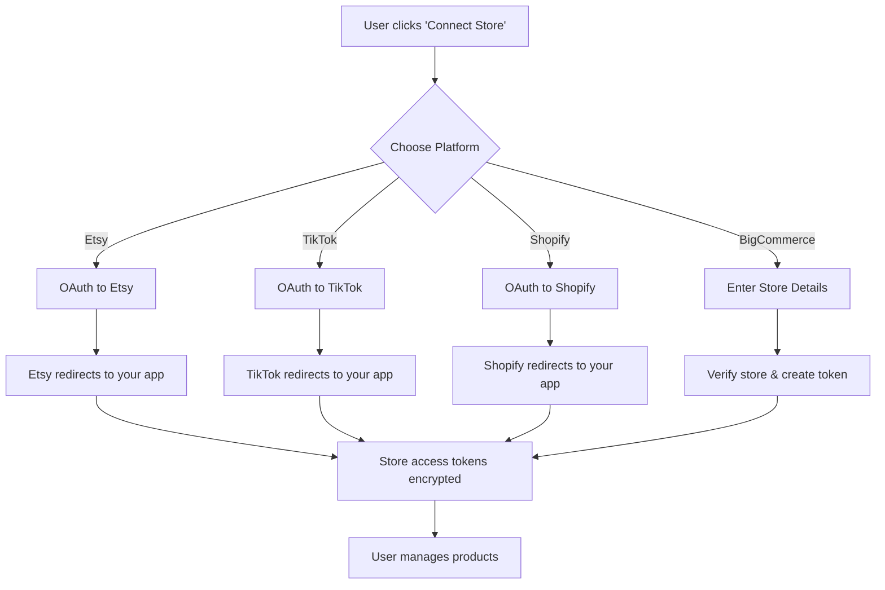

# Store Connector Architecture - TEKMS Listing Manager

## The Problem with Current Approach ❌

The current "API Credentials" page asks users to provide their own API keys. This is **fundamentally wrong** for these reasons:

1. **Etsy**: Regular sellers CANNOT get API access. Only approved developer apps can access Etsy API
2. **TikTok Shop**: Similar restrictions - requires approved business accounts
3. **Shopify**: Possible but complex - users need to create custom apps
4. **BigCommerce**: Easier but still requires technical knowledge

**Users don't want to deal with API keys. They want to click "Connect Store" and be done.**

---

## The RIGHT Architecture: OAuth Store Connectors 🎯

### How It Should Work (Like Vela, Sellbrite, etc.)



### What This Means for You

#### As App Owner (You):
1. **Register developer apps** with each platform:
   - Etsy Developer Account → Create App → Get client ID & secret
   - TikTok Shop Partner → Register App → Get credentials
   - Shopify Partners → Create App → Get credentials
   - BigCommerce Partner → Create App → Get credentials

2. **Your app stores**:
   - Client ID & Client Secret (in your .env)
   - OAuth redirect URLs pointing to your domain
   - Scopes needed for each platform

3. **Users authorize** your app to access their stores
4. **You receive & store** access tokens for each user's store
5. **Your backend** makes API calls using those tokens

#### For Users:
1. Click "Connect Etsy Store"
2. Redirected to Etsy
3. Login to their Etsy account (if not already logged in)
4. Click "Allow Access" to authorize your app
5. Redirected back to your dashboard
6. Done! ✅ No API keys, no technical setup

---

## Updated Database Schema

```prisma
// REPLACE UserCredential with StoreConnection

model StoreConnection {
  id                String   @id @default(cuid())
  userId            String
  platform          Platform
  
  // Store Info
  storeName         String   // "My Etsy Shop", "Main Shopify Store"
  storeUrl          String?  // "myshop.etsy.com", "mystore.myshopify.com"
  externalStoreId   String   // Platform's unique store ID
  
  // OAuth Tokens (encrypted)
  accessToken       String   @db.Text // Encrypted
  refreshToken      String?  @db.Text // Encrypted (for refreshing access)
  tokenExpiresAt    DateTime?
  
  // Scopes granted
  scopes            String[] // What permissions this connection has
  
  // Status
  isActive          Boolean  @default(true)
  lastSyncedAt      DateTime?
  syncStatus        String?  // "connected", "error", "needs_reauth"
  syncError         String?
  
  // Platform-specific metadata
  metadata          Json?    // Store additional platform data
  
  user User @relation(fields: [userId], references: [id], onDelete: Cascade)
  
  createdAt DateTime @default(now())
  updatedAt DateTime @updatedAt
  
  @@unique([userId, platform, externalStoreId])
  @@index([userId, platform])
  @@index([userId, isActive])
}

// Products now reference StoreConnection
model Product {
  id                  String   @id @default(cuid())
  userId              String
  storeConnectionId   String   // Link to which store this came from
  platform            Platform
  externalId          String   // Product ID on the platform
  
  // Core fields
  name                String
  description         String?  @db.Text
  sku                 String?
  price               Decimal  @db.Decimal(10, 2)
  compareAtPrice      Decimal? @db.Decimal(10, 2)
  
  // Platform-specific data
  platformData        Json?    // Store original platform data
  
  // Sync tracking
  lastSyncedAt        DateTime?
  syncStatus          String?  // "synced", "pending", "error"
  syncError           String?
  
  // Relations
  user              User @relation(fields: [userId], references: [id], onDelete: Cascade)
  storeConnection   StoreConnection @relation(fields: [storeConnectionId], references: [id])
  
  createdAt DateTime @default(now())
  updatedAt DateTime @updatedAt
  
  @@unique([storeConnectionId, externalId])
  @@index([userId, platform])
}
```

---

## Platform-Specific Implementation

### 1. Etsy OAuth Flow

```typescript
// lib/platforms/etsy/oauth.ts

export async function getEtsyAuthUrl(userId: string, state: string) {
  const params = new URLSearchParams({
    client_id: process.env.ETSY_CLIENT_ID!,
    redirect_uri: `${process.env.APP_URL}/api/auth/callback/etsy`,
    response_type: 'code',
    scope: 'listings_r listings_w shops_r', // Scopes you need
    state: state, // Prevent CSRF
  })
  
  return `https://www.etsy.com/oauth/connect?${params}`
}

export async function handleEtsyCallback(code: string, userId: string) {
  // Exchange code for access token
  const tokenResponse = await fetch('https://api.etsy.com/v3/public/oauth/token', {
    method: 'POST',
    headers: { 'Content-Type': 'application/x-www-form-urlencoded' },
    body: new URLSearchParams({
      grant_type: 'authorization_code',
      client_id: process.env.ETSY_CLIENT_ID!,
      code: code,
      redirect_uri: `${process.env.APP_URL}/api/auth/callback/etsy`,
    }),
  })
  
  const tokens = await tokenResponse.json()
  
  // Get shop info
  const shopResponse = await fetch('https://openapi.etsy.com/v3/application/shops/me', {
    headers: { 
      'Authorization': `Bearer ${tokens.access_token}`,
      'x-api-key': process.env.ETSY_CLIENT_ID!
    }
  })
  
  const shop = await shopResponse.json()
  
  // Encrypt and store tokens
  const encryptedAccess = await encrypt(tokens.access_token)
  const encryptedRefresh = tokens.refresh_token ? await encrypt(tokens.refresh_token) : null
  
  // Create StoreConnection
  await db.storeConnection.create({
    data: {
      userId: userId,
      platform: 'ETSY',
      storeName: shop.shop_name,
      storeUrl: shop.url,
      externalStoreId: shop.shop_id.toString(),
      accessToken: encryptedAccess,
      refreshToken: encryptedRefresh,
      tokenExpiresAt: new Date(Date.now() + tokens.expires_in * 1000),
      scopes: ['listings_r', 'listings_w', 'shops_r'],
      isActive: true,
      metadata: { shop }, // Store full shop data
    }
  })
  
  return { success: true, shopName: shop.shop_name }
}
```

### 2. Shopify OAuth Flow

```typescript
// lib/platforms/shopify/oauth.ts

export async function getShopifyAuthUrl(shop: string, state: string) {
  const params = new URLSearchParams({
    client_id: process.env.SHOPIFY_CLIENT_ID!,
    scope: 'read_products,write_products,read_inventory,write_inventory',
    redirect_uri: `${process.env.APP_URL}/api/auth/callback/shopify`,
    state: state,
  })
  
  return `https://${shop}/admin/oauth/authorize?${params}`
}

export async function handleShopifyCallback(code: string, shop: string, userId: string) {
  // Exchange code for access token
  const tokenResponse = await fetch(`https://${shop}/admin/oauth/access_token`, {
    method: 'POST',
    headers: { 'Content-Type': 'application/json' },
    body: JSON.stringify({
      client_id: process.env.SHOPIFY_CLIENT_ID!,
      client_secret: process.env.SHOPIFY_CLIENT_SECRET!,
      code: code,
    }),
  })
  
  const { access_token } = await tokenResponse.json()
  
  // Get shop info
  const shopResponse = await fetch(`https://${shop}/admin/api/2024-01/shop.json`, {
    headers: { 'X-Shopify-Access-Token': access_token }
  })
  
  const { shop: shopInfo } = await shopResponse.json()
  
  // Encrypt and store
  const encryptedToken = await encrypt(access_token)
  
  await db.storeConnection.create({
    data: {
      userId: userId,
      platform: 'SHOPIFY',
      storeName: shopInfo.name,
      storeUrl: shopInfo.myshopify_domain,
      externalStoreId: shopInfo.id.toString(),
      accessToken: encryptedToken,
      scopes: ['read_products', 'write_products'],
      isActive: true,
      metadata: { shop: shopInfo },
    }
  })
  
  return { success: true, shopName: shopInfo.name }
}
```

### 3. BigCommerce (API Token - Simpler)

```typescript
// lib/platforms/bigcommerce/auth.ts

export async function connectBigCommerceStore(
  userId: string,
  storeHash: string,
  accessToken: string
) {
  // Verify the token works
  const response = await fetch(
    `https://api.bigcommerce.com/stores/${storeHash}/v3/store`,
    {
      headers: {
        'X-Auth-Token': accessToken,
        'Accept': 'application/json',
      }
    }
  )
  
  if (!response.ok) {
    throw new Error('Invalid BigCommerce credentials')
  }
  
  const store = await response.json()
  
  // Encrypt and store
  const encryptedToken = await encrypt(accessToken)
  
  await db.storeConnection.create({
    data: {
      userId: userId,
      platform: 'BIGCOMMERCE',
      storeName: store.data.name || 'BigCommerce Store',
      storeUrl: store.data.domain,
      externalStoreId: storeHash,
      accessToken: encryptedToken,
      scopes: ['store_v2_products', 'store_v2_orders'], // Based on token scope
      isActive: true,
      metadata: { store: store.data },
    }
  })
  
  return { success: true, storeName: store.data.name }
}
```

---

## New UI: Store Connectors Page

### Replace `/credentials` with `/stores`

```
┌─────────────────────────────────────────────────────┐
│  My Connected Stores                    [+ Connect]  │
├─────────────────────────────────────────────────────┤
│                                                       │
│  ┌──────────────────────────────────────────────┐   │
│  │ 🟠 Etsy                                       │   │
│  │ ┌────────────────────────────────────────┐   │   │
│  │ │ ✓ GokhanVintageShop        [Manage] [×] │   │   │
│  │ │   gokhanvintage.etsy.com               │   │   │
│  │ │   Last synced: 5 mins ago              │   │   │
│  │ │   234 products                          │   │   │
│  │ └────────────────────────────────────────┘   │   │
│  └──────────────────────────────────────────────┘   │
│                                                       │
│  ┌──────────────────────────────────────────────┐   │
│  │ 🟢 Shopify                                    │   │
│  │ ┌────────────────────────────────────────┐   │   │
│  │ │ ✓ My Shopify Store         [Manage] [×] │   │   │
│  │ │   mystore.myshopify.com                │   │   │
│  │ │   Last synced: 2 hours ago             │   │   │
│  │ │   1,203 products                       │   │   │
│  │ └────────────────────────────────────────┘   │   │
│  └──────────────────────────────────────────────┘   │
│                                                       │
│  ┌──────────────────────────────────────────────┐   │
│  │ 🔵 BigCommerce                                │   │
│  │ ┌────────────────────────────────────────┐   │   │
│  │ │ ✓ Main BC Store            [Manage] [×] │   │   │
│  │ │   store-abc123.mybigcommerce.com       │   │   │
│  │ │   Last synced: 10 mins ago             │   │   │
│  │ │   567 products                          │   │   │
│  │ └────────────────────────────────────────┘   │   │
│  └──────────────────────────────────────────────┘   │
│                                                       │
│  ┌──────────────────────────────────────────────┐   │
│  │ 🎵 TikTok Shop                                │   │
│  │    No stores connected                        │   │
│  │    [Connect TikTok Shop] 🔒 PRO+              │   │
│  └──────────────────────────────────────────────┘   │
└─────────────────────────────────────────────────────┘
```

### Connect Store Modal

```
┌─────────────────────────────────────────┐
│  Connect Your Store                      │
├─────────────────────────────────────────┤
│                                           │
│  Choose Platform:                         │
│                                           │
│  [🟠 Etsy]         [🟢 Shopify]          │
│  [🔵 BigCommerce]  [🎵 TikTok Shop] 🔒   │
│                                           │
│  ─── OR ───                              │
│                                           │
│  For BigCommerce (Manual):               │
│  Store Hash: [____________]              │
│  API Token:  [____________]              │
│                                           │
│  [Cancel]  [Continue →]                  │
└─────────────────────────────────────────┘
```

---

## Product Management by Platform

### Unified Product Manager with Platform Tabs

```
/products page

┌─────────────────────────────────────────────────────┐
│  [All Platforms ▾] [Search products...]  [+ Import]  │
├─────────────────────────────────────────────────────┤
│                                                       │
│  Filters:                                             │
│  Store: [All ▾]  Category: [All ▾]  Status: [All ▾]  │
│                                                       │
│  ┌────────────────────────────────────────────────┐ │
│  │ □ [IMG] Vintage Leather Bag        $129.99    │ │
│  │     Etsy • GokhanVintageShop       Synced ✓   │ │
│  │     SKU: VLB-001                   [Edit]     │ │
│  ├────────────────────────────────────────────────┤ │
│  │ □ [IMG] Cotton T-Shirt             $24.99     │ │
│  │     Shopify • My Store             Pending ↻  │ │
│  │     SKU: CT-BLUE-M                 [Edit]     │ │
│  ├────────────────────────────────────────────────┤ │
│  │ □ [IMG] Phone Case                 $15.99     │ │
│  │     BigCommerce • Main Store       Error ⚠    │ │
│  │     SKU: PC-CLEAR                  [Edit]     │ │
│  └────────────────────────────────────────────────┘ │
│                                                       │
│  [1] [2] [3] ... [12]                 Showing 50     │
└─────────────────────────────────────────────────────┘
```

### Product Detail/Edit Page

```
/products/[id]/edit

┌─────────────────────────────────────────────────────┐
│  ← Back to Products          [Save Changes] [Delete]│
├─────────────────────────────────────────────────────┤
│                                                       │
│  Platform: 🟠 Etsy • GokhanVintageShop               │
│  Last synced: 10 minutes ago                         │
│                                                       │
│  [Basic Info] [Images] [Variants] [SEO] [Platform]  │
│                                                       │
│  ┌──────────────────────────────────────────────┐   │
│  │ Basic Information                             │   │
│  │                                               │   │
│  │ Title *                                       │   │
│  │ [Vintage Leather Shoulder Bag - Brown]       │   │
│  │ 0/140 characters (Etsy limit)                │   │
│  │                                               │   │
│  │ Description *                                 │   │
│  │ [Rich text editor...]                        │   │
│  │ 0/5000 characters (Etsy limit)               │   │
│  │                                               │   │
│  │ Price *          Compare At Price            │   │
│  │ [$129.99]        [$179.99]                   │   │
│  │                                               │   │
│  │ SKU              Quantity                     │   │
│  │ [VLB-001]        [5]                         │   │
│  │                                               │   │
│  │ Category (Etsy)                              │   │
│  │ [Bags & Purses > Shoulder Bags ▾]           │   │
│  │                                               │   │
│  │ Tags (Etsy - max 13)                         │   │
│  │ [vintage] [leather] [bag] [× ...]           │   │
│  │ 3/13 tags used                               │   │
│  └──────────────────────────────────────────────┘   │
│                                                       │
│  [Cancel] [Save Draft] [Save & Sync to Etsy]        │
└─────────────────────────────────────────────────────┘
```

### Platform-Specific Validation

```typescript
// lib/platforms/validators.ts

export const platformValidators = {
  ETSY: {
    title: {
      maxLength: 140,
      required: true,
    },
    description: {
      maxLength: 5000,
      required: true,
    },
    tags: {
      max: 13,
      maxLength: 20, // per tag
    },
    images: {
      min: 1,
      max: 10,
      maxSize: 10485760, // 10MB
    },
    categories: {
      required: true,
      levels: 2, // Category > Subcategory
    },
  },
  
  SHOPIFY: {
    title: {
      maxLength: 255,
      required: true,
    },
    description: {
      maxLength: 65535,
      required: false,
      allowHTML: true,
    },
    tags: {
      max: 250,
      separator: ',',
    },
    images: {
      max: 250,
      maxSize: 20971520, // 20MB
    },
    variants: {
      max: 100,
      optionsMax: 3,
    },
  },
  
  BIGCOMMERCE: {
    title: {
      maxLength: 255,
      required: true,
    },
    description: {
      maxLength: 65535,
      allowHTML: true,
    },
    sku: {
      maxLength: 255,
      unique: true,
    },
    images: {
      max: 50,
    },
    customFields: {
      max: 250,
    },
  },
  
  TIKTOK: {
    title: {
      maxLength: 255,
      required: true,
    },
    description: {
      maxLength: 5000,
      required: true,
    },
    images: {
      min: 1,
      max: 9,
      aspectRatio: '1:1', // Square images preferred
    },
    price: {
      min: 0.01,
      max: 999999.99,
    },
  }
}
```

---

## Detailed Implementation Roadmap

### Phase 1: OAuth Infrastructure (Week 1-2)

#### 1.1 Database Migration
- [ ] Create new `StoreConnection` model
- [ ] Migrate existing `UserCredential` data
- [ ] Update `Product` model with `storeConnectionId`
- [ ] Create migration scripts

#### 1.2 OAuth Setup per Platform
- [ ] **Etsy**: Register app, get client ID/secret
- [ ] **Shopify**: Create partner app
- [ ] **TikTok**: Apply for developer access
- [ ] **BigCommerce**: Create partner app (optional, can use manual tokens)

#### 1.3 OAuth Flow Implementation
- [ ] Create `/api/auth/connect/[platform]` routes
- [ ] Create `/api/auth/callback/[platform]` routes
- [ ] Implement token encryption/storage
- [ ] Add CSRF protection with state parameter
- [ ] Token refresh logic for expired tokens

### Phase 2: Store Connectors UI (Week 2-3)

#### 2.1 Stores Management Page
- [ ] Replace `/credentials` with `/stores`
- [ ] List connected stores by platform
- [ ] Show sync status, last synced time
- [ ] Product count per store
- [ ] Connect/disconnect actions

#### 2.2 Connect Store Flow
- [ ] Modal for choosing platform
- [ ] OAuth redirect handling
- [ ] Success/error feedback
- [ ] Store verification

#### 2.3 Store Management Actions
- [ ] Reconnect (re-auth) store
- [ ] Disconnect store
- [ ] View store details
- [ ] Manual sync trigger

### Phase 3: Product Management Overhaul (Week 3-5)

#### 3.1 Unified Product List
- [ ] View products from all stores
- [ ] Filter by store, platform, status
- [ ] Bulk actions (sync, delete, export)
- [ ] Advanced search with Meilisearch

#### 3.2 Platform-Specific Product Editor
- [ ] Dynamic form based on platform
- [ ] Real-time validation per platform rules
- [ ] Character counters
- [ ] Image upload with size/quantity limits
- [ ] Category selector (platform-specific)
- [ ] Tag management

#### 3.3 Product Sync Engine
- [ ] Import from Etsy
- [ ] Import from Shopify
- [ ] Import from BigCommerce
- [ ] Export to TikTok
- [ ] Bi-directional sync
- [ ] Conflict resolution

### Phase 4: Platform Adapters (Week 4-6)

#### 4.1 Etsy Adapter
- [ ] OAuth implementation
- [ ] Fetch shop listings
- [ ] Create/update listings
- [ ] Handle Etsy-specific fields (variations, tags)
- [ ] Image upload to Etsy
- [ ] Category mapping

#### 4.2 Shopify Adapter
- [ ] OAuth implementation
- [ ] GraphQL or REST API?
- [ ] Product import
- [ ] Variant handling
- [ ] Metafields support
- [ ] Collection management

#### 4.3 BigCommerce Adapter
- [ ] Token verification
- [ ] Product import/export
- [ ] Modifier support (existing code)
- [ ] Custom fields
- [ ] Category syncing

#### 4.4 TikTok Adapter
- [ ] OAuth implementation
- [ ] Product catalog API
- [ ] Excel export (current feature)
- [ ] Auto-upload to TikTok (future)

### Phase 5: Subscription Enforcement (Week 5-6)

#### 5.1 Feature Gates
- [ ] FREE: Can only connect 1 store per platform
- [ ] STARTER: Up to 2 stores total
- [ ] PROFESSIONAL: Unlimited stores, Etsy + TikTok access
- [ ] ENTERPRISE: API access, priority sync

#### 5.2 Usage Tracking
- [ ] Track products synced per month
- [ ] Track API calls per platform
- [ ] Prevent over-limit operations
- [ ] Auto-upgrade prompts

### Phase 6: Admin Controls (Week 6-7)

#### 6.1 Admin Dashboard
- [ ] View all connected stores (all users)
- [ ] Override connection limits per user
- [ ] Grant special permissions
- [ ] Monitor sync health
- [ ] Platform API status

#### 6.2 Admin Actions
- [ ] Force disconnect store
- [ ] Re-sync specific stores
- [ ] View store connection logs
- [ ] Platform-wide settings

---

## Environment Variables Needed

```bash
# Etsy OAuth
ETSY_CLIENT_ID="your_etsy_client_id"
ETSY_CLIENT_SECRET="your_etsy_client_secret"
ETSY_REDIRECT_URI="https://yourdomain.com/api/auth/callback/etsy"

# Shopify OAuth
SHOPIFY_CLIENT_ID="your_shopify_api_key"
SHOPIFY_CLIENT_SECRET="your_shopify_api_secret"
SHOPIFY_REDIRECT_URI="https://yourdomain.com/api/auth/callback/shopify"

# TikTok OAuth
TIKTOK_CLIENT_KEY="your_tiktok_client_key"
TIKTOK_CLIENT_SECRET="your_tiktok_client_secret"
TIKTOK_REDIRECT_URI="https://yourdomain.com/api/auth/callback/tiktok"

# BigCommerce (Optional - for OAuth vs manual tokens)
BIGCOMMERCE_CLIENT_ID="your_bc_client_id"
BIGCOMMERCE_CLIENT_SECRET="your_bc_client_secret"

# Encryption for tokens
ENCRYPTION_KEY="your-32-byte-random-string"
ENCRYPTION_ALGORITHM="aes-256-gcm"
```

---

## Key Decisions to Make

### 1. **Do we support multiple stores per platform?**
   - Example: User has 2 Etsy shops
   - Recommendation: YES, but limit by subscription tier
   - FREE: 1 store total
   - STARTER: 2 stores total
   - PRO+: Unlimited stores

### 2. **Do we store ALL product data or just reference IDs?**
   - Option A: Store full product data (faster, works offline from platform)
   - Option B: Store minimal data, fetch fresh each time (always accurate)
   - Recommendation: **Option A** - Store full data for search & speed

### 3. **Bi-directional sync or one-way?**
   - Option A: User edits in TEKMS, pushes to platforms (one-way)
   - Option B: Changes on platform sync back to TEKMS (bi-directional)
   - Recommendation: **Start with A**, add B later with webhooks

### 4. **What happens to products when store is disconnected?**
   - Option A: Keep products, mark as "orphaned"
   - Option B: Delete products
   - Recommendation: **Option A** - Let user keep data, can't sync anymore

---

## Summary: What Changes from Current System

### OLD (Wrong) ❌
- User provides raw API keys
- Impossible for Etsy/TikTok (no regular user access)
- Complex, technical, error-prone
- No store identity, just credentials

### NEW (Right) ✅
- OAuth "Connect Store" flow
- Users just click and authorize
- Store connections with names, URLs, metadata
- Per-platform product management
- Proper subscription enforcement
- Admin can manage all connections
- Professional SaaS experience

---

## Next Steps

1. **Review & Approve** this architecture
2. **I'll update the database schema** with StoreConnection model
3. **Register OAuth apps** (you'll need to do this for Etsy)
4. **Implement OAuth flows** one platform at a time
5. **Build new UI** for store connectors
6. **Migrate existing data** if any

**This is the RIGHT way to build a marketplace SaaS product.** 🚀