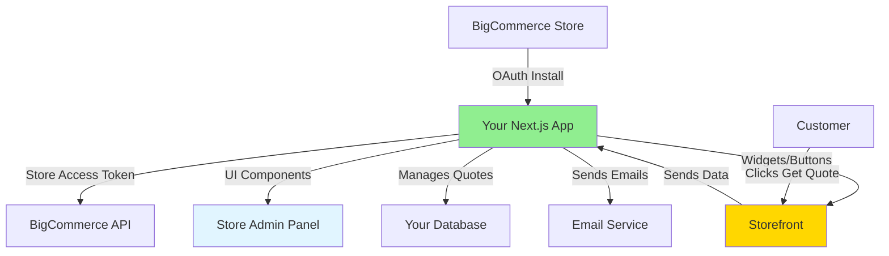

# Building a Custom BigCommerce App - "Get a Quote" Feature

## Yes, You Can Build Your Own BigCommerce App! 🎉

Your Next.js app can become a proper BigCommerce app that:
- Integrates directly into your BigCommerce store
- Shows up in the BigCommerce admin panel
- Can add buttons/widgets to your storefront
- Uses official BigCommerce APIs with proper authentication
- Can be installed on multiple stores (yours or others)

## How BigCommerce Apps Work



## Architecture of a BigCommerce App

### 1. **App Types**

#### Single-Click App (Recommended for You)
- Installed via BigCommerce admin
- OAuth authentication
- Can access all BigCommerce APIs
- Can add UI to admin panel
- Can inject content into storefront

#### Script/Widget App
- Simpler, just adds JavaScript/HTML
- No OAuth needed
- Limited functionality

### 2. **Your Next.js App as a BigCommerce App**

Your existing Next.js app can easily become a BigCommerce app with these additions:

```
your-nextjs-app/
├── app/
│   ├── api/
│   │   ├── auth/
│   │   │   ├── callback/route.ts     # OAuth callback
│   │   │   └── install/route.ts      # App installation
│   │   ├── load/route.ts             # Admin panel load
│   │   ├── uninstall/route.ts        # App removal
│   │   └── quotes/
│   │       ├── submit/route.ts       # Quote submission
│   │       └── list/route.ts         # Admin view quotes
│   └── admin/
│       └── page.tsx                  # Admin dashboard (embedded in BC)
├── .env.local
│   ├── BIGCOMMERCE_CLIENT_ID
│   ├── BIGCOMMERCE_CLIENT_SECRET
│   └── APP_URL
└── lib/
    └── bigcommerce-auth.ts           # OAuth handling
```

## Implementation Plan

### Phase 1: Register Your App with BigCommerce

1. **Go to BigCommerce DevTools**
   - Login to: https://devtools.bigcommerce.com
   - Click "Create an App"

2. **Configure App Settings**
   ```
   App Name: Quote Request System
   Auth Callback URL: https://your-app.vercel.app/api/auth/callback
   Load Callback URL: https://your-app.vercel.app/api/load
   Uninstall Callback URL: https://your-app.vercel.app/api/uninstall
   
   OAuth Scopes Required:
   - Products: read-only
   - Customers: read-only
   - Store Information: read-only
   - Content: modify (for widgets)
   ```

3. **Get Credentials**
   ```env
   BIGCOMMERCE_CLIENT_ID=your_client_id
   BIGCOMMERCE_CLIENT_SECRET=your_client_secret
   BIGCOMMERCE_APP_URL=https://your-app.vercel.app
   ```

### Phase 2: Add OAuth Flow to Your Next.js App

#### `/app/api/auth/callback/route.ts`
```typescript
import { NextRequest, NextResponse } from 'next/server'
import { exchangeCodeForToken, storeAccessToken } from '@/lib/bigcommerce-auth'

export async function GET(request: NextRequest) {
  const searchParams = request.nextUrl.searchParams
  const code = searchParams.get('code')
  const scope = searchParams.get('scope')
  const context = searchParams.get('context')
  
  if (!code || !scope || !context) {
    return NextResponse.json({ error: 'Missing parameters' }, { status: 400 })
  }
  
  try {
    // Exchange code for access token
    const tokenData = await exchangeCodeForToken(code, scope, context)
    
    // Store access token in your database
    await storeAccessToken(context, tokenData)
    
    // Redirect to load callback
    return NextResponse.redirect(
      `${process.env.BIGCOMMERCE_APP_URL}/api/load?signed_payload=${tokenData.context}`
    )
  } catch (error) {
    console.error('OAuth error:', error)
    return NextResponse.json({ error: 'Installation failed' }, { status: 500 })
  }
}
```

#### `/app/api/load/route.ts`
```typescript
import { NextRequest, NextResponse } from 'next/server'
import { verifySignedRequest } from '@/lib/bigcommerce-auth'

export async function GET(request: NextRequest) {
  const signedPayload = request.nextUrl.searchParams.get('signed_payload')
  
  if (!signedPayload) {
    return NextResponse.json({ error: 'No signed payload' }, { status: 400 })
  }
  
  try {
    // Verify and decode the signed request
    const data = verifySignedRequest(signedPayload)
    
    // Render your admin interface
    return NextResponse.redirect(
      `${process.env.BIGCOMMERCE_APP_URL}/admin?store_hash=${data.store_hash}`
    )
  } catch (error) {
    return NextResponse.json({ error: 'Invalid signature' }, { status: 401 })
  }
}
```

### Phase 3: Add Storefront Widget

BigCommerce apps can inject content into the storefront using **Widgets**.

#### Create Widget Manifest
```typescript
// POST to BigCommerce API
const widget = {
  name: "Get a Quote Button",
  widget_template_uuid: "your-template-uuid",
  schema: [
    {
      type: "tab",
      label: "Settings",
      sections: [
        {
          label: "Button Settings",
          settings: [
            {
              type: "text",
              label: "Button Text",
              id: "button_text",
              default: "Get a Quote"
            }
          ]
        }
      ]
    }
  ]
}
```

#### Widget Template (HTML/JavaScript)
```html
<!-- This gets injected into product pages -->
<div id="quote-widget-{{widget_id}}">
  <button 
    class="button button--primary quote-button"
    data-product-id="{{product.id}}"
    data-product-name="{{product.name}}"
    data-product-sku="{{product.sku}}"
    data-product-price="{{product.price}}"
  >
    {{button_text}}
  </button>
</div>

<script>
(function() {
  const button = document.querySelector('.quote-button');
  
  button.addEventListener('click', async (e) => {
    e.preventDefault();
    
    const productData = {
      id: e.target.dataset.productId,
      name: e.target.dataset.productName,
      sku: e.target.dataset.productSku,
      price: e.target.dataset.productPrice
    };
    
    // Open modal and submit to your app
    openQuoteModal(productData);
  });
  
  function openQuoteModal(product) {
    // Your modal code here
    // Submits to: https://your-app.vercel.app/api/quotes/submit
  }
})();
</script>
```

### Phase 4: Admin Dashboard

Your Next.js app can render an admin interface that shows inside BigCommerce:

#### `/app/admin/page.tsx`
```typescript
'use client'

import { useEffect, useState } from 'react'
import { Card, CardHeader, CardTitle, CardContent } from '@/components/ui/card'

export default function AdminDashboard() {
  const [quotes, setQuotes] = useState([])
  
  useEffect(() => {
    fetchQuotes()
  }, [])
  
  async function fetchQuotes() {
    const response = await fetch('/api/quotes/list')
    const data = await response.json()
    setQuotes(data.quotes)
  }
  
  return (
    <div className="p-6">
      <h1 className="text-2xl font-bold mb-6">Quote Requests</h1>
      
      <div className="grid gap-4">
        {quotes.map(quote => (
          <Card key={quote.id}>
            <CardHeader>
              <CardTitle>{quote.customer.name}</CardTitle>
            </CardHeader>
            <CardContent>
              <p>Product: {quote.product.name}</p>
              <p>Quantity: {quote.quantity}</p>
              <p>Email: {quote.customer.email}</p>
            </CardContent>
          </Card>
        ))}
      </div>
    </div>
  )
}
```

This page will be embedded inside the BigCommerce admin panel!

## Benefits of Building a BigCommerce App

✅ **Professional Integration**
- Shows up in BigCommerce admin navigation
- Native look and feel
- Official OAuth authentication

✅ **Better User Experience**
- Merchants install with one click
- No manual API key configuration
- Automatic updates

✅ **Storefront Integration**
- Widgets can be placed anywhere via Page Builder
- Works with any theme
- No theme editing required

✅ **Scalability**
- Can be used on multiple stores
- Could be sold on BigCommerce Marketplace
- Proper multi-tenant architecture

✅ **Security**
- OAuth tokens instead of API keys
- BigCommerce handles authentication
- Secure signed requests

## Development Steps

### 1. Setup Development Environment
```bash
# Install BigCommerce SDK (optional but helpful)
npm install @bigcommerce/node-api-client

# Add environment variables
BIGCOMMERCE_CLIENT_ID=your_client_id
BIGCOMMERCE_CLIENT_SECRET=your_client_secret
BIGCOMMERCE_APP_URL=https://your-app.vercel.app
JWT_SECRET=your_jwt_secret
```

### 2. Create OAuth Routes
- `/api/auth/callback` - Handle installation
- `/api/load` - Load admin interface
- `/api/uninstall` - Handle app removal

### 3. Build Admin Interface
- Quote management dashboard
- Settings page
- Product selection for quote-only mode

### 4. Create Widgets
- "Get a Quote" button widget
- Quote form modal
- Storefront integration

### 5. Test & Deploy
- Test on BigCommerce sandbox store
- Deploy to Vercel/production
- Submit for review (if going to marketplace)

## Comparison: Custom App vs External Integration

| Feature | Custom BC App | External API |
|---------|--------------|--------------|
| Installation | One-click | Manual setup |
| Admin Panel | Integrated | Separate site |
| Storefront | Widgets | Theme editing |
| Authentication | OAuth | API keys |
| Updates | Automatic | Manual |
| Multi-store | Yes | Requires work |
| Marketplace | Can sell it | No |
| Complexity | Medium | Low |
| **Recommended?** | ✅ **Yes** | ⚠️ For simple use |

## Next Steps

Would you like me to:

1. **Build the OAuth flow** - Add authentication to your Next.js app
2. **Create the admin dashboard** - Quote management interface
3. **Build the widget** - Storefront "Get a Quote" button
4. **Complete implementation** - Full BigCommerce app

This would transform your existing Next.js app into a proper BigCommerce app that integrates seamlessly!