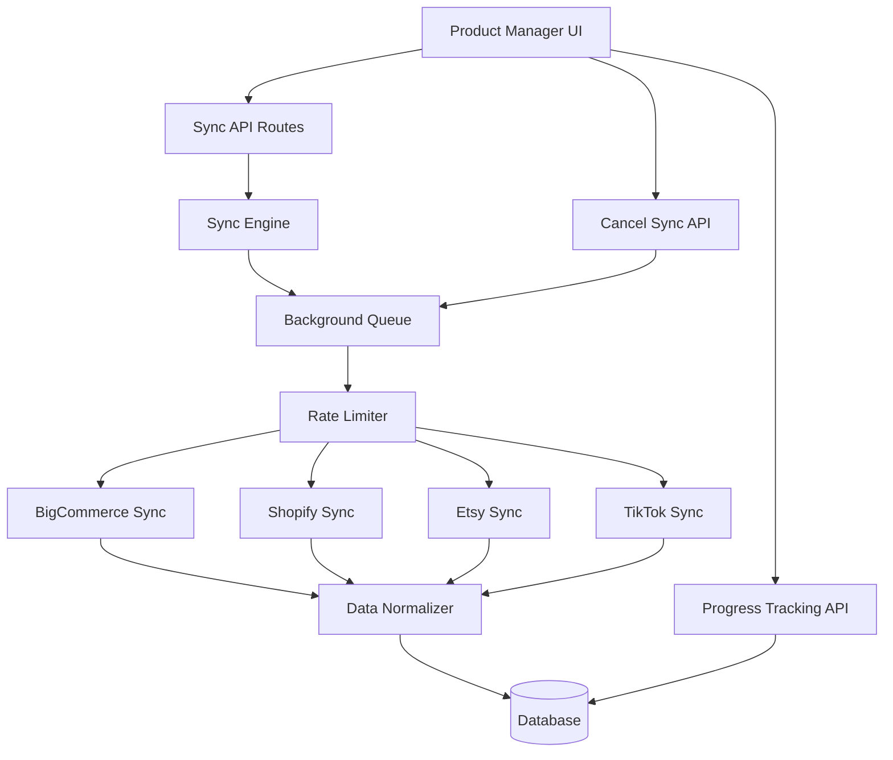
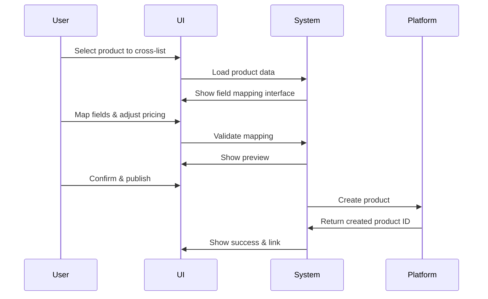

# Full Sync & Cross-Listing System Architecture

## 🎯 Overview

This document outlines the architecture for a comprehensive multi-platform product sync and cross-listing system that:
- Pulls **complete product data** from BigCommerce, Shopify, Etsy, and TikTok
- Provides **advanced product editing** with all platform-specific fields
- Enables **seamless cross-listing** between platforms
- Shows **real-time sync progress** with pause/cancel capabilities
- Respects **subscription-based rate limits**

---

## 📊 System Architecture



---

## 🔄 Full Sync Data Points

### BigCommerce - Complete Product Data
1. **Basic Info**: name, description, SKU, type, weight, dimensions
2. **Pricing**: price, cost_price, retail_price, sale_price, map_price
3. **Inventory**: inventory_level, inventory_warning_level, inventory_tracking
4. **Variants**: Full variant tree with SKU, price, inventory, weight, images
5. **Modifiers**: Dropdown, text, checkbox, file upload fields
6. **Options**: Color, size, material variations with values
7. **Custom Fields**: All metadata fields
8. **Images**: All images with URLs, alt text, sort order
9. **Videos**: Product videos
10. **SEO**: meta_description, page_title, search_keywords, URL
11. **Categories**: Category assignments with breadcrumbs
12. **Bulk Pricing**: Quantity-based pricing rules
13. **Shipping**: Fixed shipping cost, free shipping flags
14. **Condition**: New, used, refurbished
15. **Brand**: Brand ID and name
16. **Tax**: Tax class, tax code
17. **Availability**: Available, disabled, preorder
18. **Reviews**: Rating and review count
19. **Related Products**: Cross-sells, up-sells
20. **Rules**: Complex product rules

### Other Platforms (Similar Comprehensive Data)
- **Shopify**: Collections, metafields, inventory policies
- **Etsy**: Taxonomy, materials, shipping profiles
- **TikTok**: Product attributes, compliance fields

---

## 🗄️ Enhanced Database Schema

### Product Table Extensions
```prisma
model Product {
  // ... existing fields ...
  
  // Enhanced metadata storage
  fullData          Json?     // Complete platform response
  
  // Normalized fields
  variants          ProductVariant[]
  modifiers         ProductModifier[]
  options           ProductOption[]
  customFields      ProductCustomField[]
  seoData           ProductSEO?
  inventoryData     ProductInventory[]
  shippingData      ProductShipping?
  bulkPricing       ProductBulkPricing[]
  reviews           ProductReview[]
  relatedProducts   Json?
  
  // Cross-listing
  crossListings     CrossListing[]
  fieldMappings     Json?     // Platform-specific field mappings
}

model ProductVariant {
  id                String   @id @default(cuid())
  productId         String
  platform          Platform
  externalId        String
  
  sku               String?
  name              String?
  price             Decimal  @db.Decimal(10, 2)
  compareAtPrice    Decimal? @db.Decimal(10, 2)
  costPrice         Decimal? @db.Decimal(10, 2)
  
  inventoryLevel    Int      @default(0)
  inventoryTracking Boolean  @default(true)
  weight            Decimal? @db.Decimal(10, 2)
  
  optionValues      Json     // { "Color": "Red", "Size": "Large" }
  images            Json?
  dimensions        Json?
  
  platformData      Json?
  
  product           Product  @relation(fields: [productId], references: [id], onDelete: Cascade)
  
  createdAt         DateTime @default(now())
  updatedAt         DateTime @updatedAt
  
  @@unique([productId, platform, externalId])
  @@index([productId])
  @@index([sku])
}

model ProductModifier {
  id                String   @id @default(cuid())
  productId         String
  platform          Platform
  externalId        String
  
  name              String
  displayName       String
  type              String   // dropdown, text, checkbox, file, etc.
  required          Boolean  @default(false)
  
  values            Json?    // For dropdown/radio options
  validation        Json?    // Min/max, regex, etc.
  
  platformData      Json?
  
  product           Product  @relation(fields: [productId], references: [id], onDelete: Cascade)
  
  createdAt         DateTime @default(now())
  updatedAt         DateTime @updatedAt
  
  @@unique([productId, platform, externalId])
  @@index([productId])
}

model ProductOption {
  id                String   @id @default(cuid())
  productId         String
  platform          Platform
  
  name              String   // "Color", "Size", etc.
  displayName       String
  type              String   // swatch, dropdown, radio
  
  values            Json     // [{ label: "Red", value: "red", hex: "#FF0000" }]
  
  product           Product  @relation(fields: [productId], references: [id], onDelete: Cascade)
  
  createdAt         DateTime @default(now())
  updatedAt         DateTime @updatedAt
  
  @@index([productId])
}

model ProductCustomField {
  id                String   @id @default(cuid())
  productId         String
  platform          Platform
  
  name              String
  value             String   @db.Text
  
  product           Product  @relation(fields: [productId], references: [id], onDelete: Cascade)
  
  @@unique([productId, platform, name])
  @@index([productId])
}

model ProductSEO {
  id                String   @id @default(cuid())
  productId         String   @unique
  
  metaTitle         String?
  metaDescription   String?  @db.Text
  searchKeywords    String[]
  urlSlug           String?
  
  // Platform-specific
  platformSEO       Json?    // Different fields per platform
  
  product           Product  @relation(fields: [productId], references: [id], onDelete: Cascade)
  
  updatedAt         DateTime @updatedAt
}

model ProductInventory {
  id                String   @id @default(cuid())
  productId         String
  variantId         String?  // Null for simple products
  locationId        String?  // For multi-location inventory
  
  quantity          Int      @default(0)
  tracking          String   // "product", "variant", "none"
  warningLevel      Int      @default(5)
  
  product           Product  @relation(fields: [productId], references: [id], onDelete: Cascade)
  
  updatedAt         DateTime @updatedAt
  
  @@unique([productId, variantId, locationId])
  @@index([productId])
  @@index([quantity])
}

model ProductShipping {
  id                String   @id @default(cuid())
  productId         String   @unique
  
  weight            Decimal? @db.Decimal(10, 2)
  weightUnit        String?  // "lb", "kg"
  
  width             Decimal? @db.Decimal(10, 2)
  height            Decimal? @db.Decimal(10, 2)
  depth             Decimal? @db.Decimal(10, 2)
  dimensionUnit     String?  // "in", "cm"
  
  fixedCost         Decimal? @db.Decimal(10, 2)
  freeShipping      Boolean  @default(false)
  
  product           Product  @relation(fields: [productId], references: [id], onDelete: Cascade)
  
  updatedAt         DateTime @updatedAt
}

model ProductBulkPricing {
  id                String   @id @default(cuid())
  productId         String
  
  minQuantity       Int
  maxQuantity       Int?
  price             Decimal  @db.Decimal(10, 2)
  type              String   // "fixed", "percent"
  
  product           Product  @relation(fields: [productId], references: [id], onDelete: Cascade)
  
  @@index([productId])
}

model ProductReview {
  id                String   @id @default(cuid())
  productId         String
  platform          Platform
  externalId        String
  
  rating            Int
  reviewCount       Int      @default(0)
  
  product           Product  @relation(fields: [productId], references: [id], onDelete: Cascade)
  
  @@unique([productId, platform])
  @@index([productId])
}

model CrossListing {
  id                String   @id @default(cuid())
  sourceProductId   String   // Original product
  targetStoreId     String   // Where to list
  targetPlatform    Platform
  
  status            String   // "draft", "mapping", "ready", "published", "failed"
  
  // Field mappings
  titleTemplate     String?
  descriptionTemplate String? @db.Text
  priceAdjustment   Json?    // Markup rules
  categoryMapping   Json?    // Platform-specific category
  tagMapping        Json?
  
  // Publishing result
  externalId        String?  // ID on target platform
  publishedAt       DateTime?
  publishError      String?  @db.Text
  
  sourceProduct     Product  @relation(fields: [sourceProductId], references: [id], onDelete: Cascade)
  
  createdAt         DateTime @default(now())
  updatedAt         DateTime @updatedAt
  
  @@unique([sourceProductId, targetStoreId])
  @@index([status])
}
```

---

## 🔄 Enhanced Sync Implementation

### 1. Sync Job Enhancement

```typescript
interface SyncProgress {
  stage: 'products' | 'variants' | 'modifiers' | 'images' | 'inventory' | 'seo'
  currentStage: string
  totalStages: number
  completedStages: number
  
  totalItems: number
  processedItems: number
  failedItems: number
  
  currentItem?: string
  estimatedTimeRemaining?: number
  
  canCancel: boolean
  canPause: boolean
}

interface SyncJobExtended extends SyncJob {
  stages: {
    name: string
    status: 'pending' | 'processing' | 'completed' | 'failed'
    itemsProcessed: number
    totalItems: number
  }[]
  
  isPaused: boolean
  cancelRequested: boolean
  cancellationReason?: string
}
```

### 2. BigCommerce Full Sync Flow

```typescript
async function fullSyncBigCommerce(store: StoreConnection, jobId: string) {
  const stages = [
    'products',
    'variants', 
    'modifiers',
    'options',
    'custom_fields',
    'images',
    'videos',
    'categories',
    'bulk_pricing',
    'inventory',
    'seo',
    'reviews'
  ]
  
  for (const stage of stages) {
    // Check for cancellation
    if (await shouldCancelSync(jobId)) {
      await markSyncAsCancelled(jobId)
      return
    }
    
    // Update stage
    await updateSyncStage(jobId, stage)
    
    // Fetch data with rate limiting
    const data = await fetchStageData(store, stage)
    
    // Normalize and save
    await normalizeAndSave(data, stage, jobId)
    
    // Update progress
    await updateProgress(jobId, stage)
  }
  
  await completeSyncJob(jobId)
}
```

### 3. Rate Limiting Integration

```typescript
class SubscriptionAwareRateLimiter {
  async checkAndWait(userId: string, storeId: string) {
    // Get user's subscription tier
    const subscription = await getStoreSubscription(storeId)
    
    // Get tier limits
    const limits = await getTierLimits(subscription.pricingTierId)
    
    // Check current usage
    const usage = await getCurrentUsage(userId)
    
    // Apply rate limiting based on tier
    if (usage.requestsPerMinute >= limits.requestsPerMinute) {
      await sleep(calculateBackoff(usage, limits))
    }
    
    // Track usage
    await trackUsage(userId, storeId)
  }
}
```

---

## 🎨 Advanced Product Edit Interface

### Component Structure

```
ProductEditPage/
├── Header (Save, Cancel, Preview)
├── TabNavigation
│   ├── Basic Info
│   ├── Variants
│   ├── Modifiers & Options
│   ├── Images & Media
│   ├── Inventory
│   ├── SEO & Marketing
│   ├── Shipping
│   ├── Categories
│   ├── Custom Fields
│   ├── Cross-Listing
│   └── Platform Data
└── Footer (Save, Publish)
```

### Tab Designs

#### 1. Basic Info Tab
- Name, Description (rich text editor)
- SKU, Price, Compare Price
- Product Type, Brand
- Condition, Availability

#### 2. Variants Tab
- Variant table with inline editing
- Option management (Color, Size, etc.)
- Bulk variant creation
- Per-variant pricing, SKU, inventory, images

#### 3. Modifiers & Options Tab
- Modifier list (text fields, dropdowns, checkboxes)
- Option values with pricing adjustments
- Conditional display rules

#### 4. Images & Media Tab
- Drag-and-drop image reordering
- Image per variant assignment
- Video uploads
- Alt text for SEO

#### 5. Inventory Tab
- Multi-location inventory tracking
- Low stock alerts
- Inventory history

#### 6. SEO & Marketing Tab
- Meta title, description
- Search keywords
- URL slug
- Platform-specific SEO fields

#### 7. Cross-Listing Tab
- Select target platforms
- Field mapping interface
- Price adjustment rules
- Preview before publish

---

## 🚀 Implementation Phases

### Phase 1: Enhanced Sync Engine (Week 1-2)
- Update BigCommerce sync to fetch all data points
- Implement staged sync with progress tracking
- Add pause/cancel functionality
- Integrate rate limiting checks

### Phase 2: Database & Data Layer (Week 2-3)
- Create database migrations for new tables
- Build data normalization layer
- Implement platform-specific parsers

### Phase 3: Progress UI (Week 3)
- Enhanced SyncProgressDialog with stages
- Cancel/pause buttons
- Estimated time remaining
- Detailed error reporting

### Phase 4: Advanced Edit Interface (Week 4-6)
- Build tabbed product editor
- Implement variant management UI
- Add modifier/options editor
- Create image manager
- Build SEO editor

### Phase 5: Cross-Listing (Week 7-8)
- Field mapping system
- Category mapping per platform
- Publishing workflow
- Conflict resolution

### Phase 6: Testing & Optimization (Week 9)
- Load testing with large catalogs
- Rate limit validation
- Multi-platform testing
- User acceptance testing

---

## 🔐 Security & Performance

### Rate Limiting Strategy
```typescript
interface RateLimitConfig {
  free: {
    requestsPerMinute: 10,
    requestsPerHour: 300,
    maxConcurrentSyncs: 1
  },
  paid: {
    requestsPerMinute: 30,
    requestsPerHour: 1500,
    maxConcurrentSyncs: 3
  },
  enterprise: {
    requestsPerMinute: 100,
    requestsPerHour: 5000,
    maxConcurrentSyncs: 10
  }
}
```

### Caching Strategy
- Cache product data for 5 minutes
- Invalidate on sync completion
- Use Redis for distributed caching

### Background Processing
- Use Bull queue for long-running syncs
- Implement job retry logic
- Store partial progress for resume capability

---

## 📊 Success Metrics

- **Sync Performance**: < 5 minutes for 1000 products
- **Data Completeness**: 100% of available fields synced
- **Error Rate**: < 1% failed items
- **Rate Limit Compliance**: 0 limit violations
- **User Satisfaction**: Easy cross-listing workflow

---

## 🔄 Cross-Listing Workflow



---

## 🎯 Key Features

✅ **Complete Data Sync**: All product fields from all platforms  
✅ **Real-time Progress**: Stage-by-stage sync tracking  
✅ **Pause/Cancel**: Full control over sync operations  
✅ **Rate Limiting**: Subscription-tier aware  
✅ **Advanced Editing**: Comprehensive product editor  
✅ **Cross-Listing**: Easy multi-platform publishing  
✅ **Field Mapping**: Platform-specific field translation  
✅ **Conflict Resolution**: Handle sync conflicts gracefully  
✅ **Bulk Operations**: Edit multiple products at once  
✅ **Version History**: Track all changes
