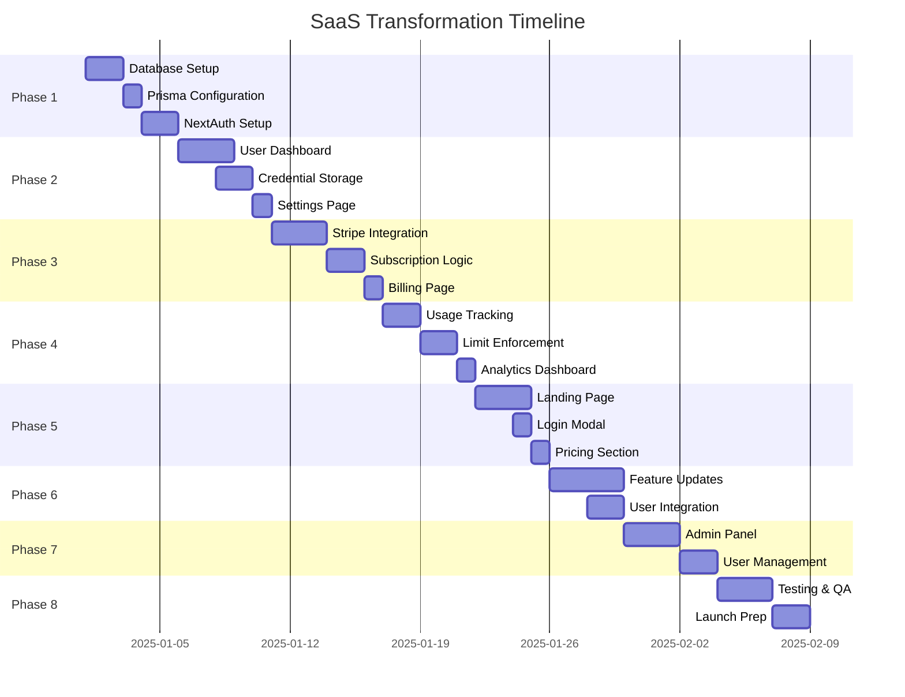

# Implementation Roadmap
## Multi-Channel E-commerce Automation Platform

**Project Duration:** 4-5 weeks  
**Last Updated:** 2025-10-09

---

## Quick Reference

### Tech Stack Summary
- **Database:** DigitalOcean PostgreSQL + Prisma ORM
- **Auth:** NextAuth.js v5 + Google OAuth
- **Payments:** Stripe
- **Email:** Resend/SendGrid
- **Frontend:** Next.js 15 + TypeScript + Tailwind CSS

### Key Deliverables
1. ✅ Landing page with login
2. ✅ User authentication system
3. ✅ Credential management (encrypted)
4. ✅ Subscription system (Free + 3 paid tiers)
5. ✅ Usage tracking & limits
6. ✅ Admin dashboard
7. ✅ Updated features with auth

---

## Implementation Timeline



---

## Phase-by-Phase Breakdown

### 🔷 Phase 1: Foundation (Days 1-5)

#### Tasks
1. **Set up DigitalOcean PostgreSQL**
   - Create database cluster
   - Configure connection pooling
   - Set up SSL certificates
   - Test connection

2. **Install Prisma ORM**
   ```bash
   npm install prisma @prisma/client
   npm install -D prisma
   npx prisma init
   ```

3. **Configure NextAuth.js**
   ```bash
   npm install next-auth @next-auth/prisma-adapter
   ```
   - Set up Google OAuth provider
   - Configure session strategy
   - Create auth API routes

4. **Create Database Schema**
   - User & Account tables
   - Session management
   - Subscription tables
   - Credentials storage
   - Usage tracking

5. **Run Migrations**
   ```bash
   npx prisma migrate dev --name init
   npx prisma generate
   ```

#### Deliverables
- ✅ Working database connection
- ✅ User authentication with Google
- ✅ Session management
- ✅ Basic middleware protection

#### Testing Checklist
- [ ] Database connection successful
- [ ] Can create user via Google OAuth
- [ ] Session persists across page refreshes
- [ ] Protected routes redirect unauthenticated users

---

### 🔷 Phase 2: User Management (Days 6-11)

#### Tasks
1. **Create Dashboard Layout**
   - Sidebar navigation
   - Top navigation with user menu
   - Mobile responsive design
   - Theme support (dark/light)

2. **Build Credential Management**
   - Credential form component
   - Encryption service
   - API routes for CRUD operations
   - Platform-specific credential fields

3. **User Settings Page**
   - Profile information
   - Email preferences
   - Account deletion option

4. **Implement Encryption System**
   ```typescript
   // AES-256-GCM encryption
   encryptCredential(data) → encrypted string
   decryptCredential(encrypted) → original data
   ```

#### Deliverables
- ✅ User dashboard with navigation
- ✅ Encrypted credential storage
- ✅ Settings management
- ✅ User profile display

#### Testing Checklist
- [ ] Can add/edit/delete credentials
- [ ] Credentials are encrypted in database
- [ ] Can switch between platforms
- [ ] Settings persist correctly

---

### 🔷 Phase 3: Subscriptions (Days 12-17)

#### Tasks
1. **Stripe Setup**
   ```bash
   npm install stripe
   ```
   - Create Stripe account
   - Set up products and prices
   - Configure webhook endpoint

2. **Subscription Management**
   - Checkout session creation
   - Customer portal integration
   - Subscription status tracking
   - Automatic tier updates

3. **Billing Page**
   - Current plan display
   - Usage statistics
   - Upgrade/downgrade options
   - Payment history

4. **Webhook Handlers**
   - `checkout.session.completed`
   - `customer.subscription.updated`
   - `customer.subscription.deleted`
   - `invoice.payment_failed`

#### Deliverables
- ✅ Working Stripe integration
- ✅ Subscription tier assignment
- ✅ Billing page with upgrade options
- ✅ Webhook processing

#### Testing Checklist
- [ ] Can subscribe to paid plan
- [ ] Webhooks update database correctly
- [ ] Customer portal accessible
- [ ] Cancellation works properly

---

### 🔷 Phase 4: Usage & Limits (Days 18-22)

#### Tasks
1. **Usage Tracking Service**
   - Track product operations
   - Monthly usage calculation
   - Platform-specific tracking

2. **Limit Enforcement**
   - Check limits before operations
   - Display usage warnings
   - Prevent operations when limit reached

3. **Usage Dashboard**
   - Current month usage
   - Historical charts
   - Per-platform breakdown
   - Export usage data

4. **Rate Limiting**
   - API rate limits per tier
   - Prevent abuse
   - Clear error messages

#### Deliverables
- ✅ Usage tracking system
- ✅ Limit enforcement on all features
- ✅ Usage analytics page
- ✅ Free tier: 10 products/month limit

#### Testing Checklist
- [ ] Usage increments correctly
- [ ] Limits enforced at tier boundaries
- [ ] Usage resets monthly
- [ ] Analytics display accurately

---

### 🔷 Phase 5: Landing Page (Days 23-26)

#### Tasks
1. **Hero Section**
   - Compelling headline
   - Feature highlights
   - Primary CTA button
   - Hero animation/image

2. **Features Section**
   - BigCommerce integration card
   - TikTok export card
   - Etsy import card
   - Benefit statements

3. **Pricing Section**
   - 4-tier comparison table
   - Feature comparison
   - CTA buttons per tier
   - Popular tier badge

4. **Login Modal**
   - Google OAuth button
   - Loading states
   - Error handling
   - Success redirect

5. **Additional Sections**
   - How it works (3 steps)
   - FAQ accordion
   - Footer with links

#### Deliverables
- ✅ Professional landing page
- ✅ Pricing comparison table
- ✅ Login modal with Google OAuth
- ✅ Mobile responsive design

#### Testing Checklist
- [ ] All CTAs trigger login modal
- [ ] Google auth works from landing page
- [ ] Pricing table displays correctly
- [ ] Mobile navigation works

---

### 🔷 Phase 6: Feature Integration (Days 27-32)

#### Tasks
1. **Update BigCommerce Features**
   - Require authentication
   - Use user credentials
   - Track usage
   - Enforce limits

2. **Update TikTok Export**
   - User-specific credentials
   - Usage tracking
   - Limit enforcement

3. **Update Etsy Import**
   - Credential integration
   - Track imported products
   - Apply limits

4. **Shared Updates**
   - Remove hardcoded credentials
   - Add auth checks to all routes
   - Implement usage tracking
   - Show limit warnings

#### Deliverables
- ✅ All features require login
- ✅ All features use user credentials
- ✅ All operations tracked
- ✅ Limits enforced everywhere

#### Testing Checklist
- [ ] Cannot access features without login
- [ ] User credentials work for API calls
- [ ] Usage increments on operations
- [ ] Limits prevent operations

---

### 🔷 Phase 7: Admin Panel (Days 33-37)

#### Tasks
1. **Admin Dashboard**
   - User statistics
   - Revenue metrics
   - Active subscriptions chart
   - System health indicators

2. **User Management**
   - User list with search
   - User detail view
   - Manual subscription adjustment
   - Account suspension

3. **Analytics Views**
   - Usage trends
   - Popular features
   - Conversion metrics
   - Churn analysis

4. **Role-Based Access**
   - Admin role assignment
   - Permission middleware
   - Admin-only routes

#### Deliverables
- ✅ Admin dashboard
- ✅ User management interface
- ✅ Analytics and reports
- ✅ Role-based permissions

#### Testing Checklist
- [ ] Only admins can access admin panel
- [ ] Can view all users
- [ ] Can modify subscriptions
- [ ] Analytics display correctly

---

### 🔷 Phase 8: Testing & Launch (Days 38-42)

#### Tasks
1. **End-to-End Testing**
   - User registration flow
   - Credential management
   - Subscription lifecycle
   - Feature operations
   - Usage tracking

2. **Security Audit**
   - Credential encryption
   - API route protection
   - Input validation
   - CSRF protection

3. **Performance Optimization**
   - Database query optimization
   - API response caching
   - Image optimization
   - Bundle size reduction

4. **Documentation**
   - User guide
   - API documentation
   - Admin guide
   - Troubleshooting

5. **Production Deployment**
   - Environment setup
   - Database migration
   - Stripe webhook configuration
   - Domain configuration
   - SSL certificates

#### Deliverables
- ✅ Fully tested application
- ✅ Security hardened
- ✅ Performance optimized
- ✅ Production deployment

#### Testing Checklist
- [ ] All user flows work
- [ ] No security vulnerabilities
- [ ] Performance meets targets
- [ ] Documentation complete
- [ ] Production environment ready

---

## Critical Dependencies

### External Services Required

1. **DigitalOcean Account**
   - PostgreSQL database cluster
   - Estimated cost: $15-30/month (start small, scale up)

2. **Google Cloud Console**
   - OAuth 2.0 credentials
   - Configure authorized redirect URIs

3. **Stripe Account**
   - Create products and prices
   - Set up webhook endpoint
   - Test mode vs. production mode

4. **Email Service (Choose One)**
   - Resend (recommended, $0-20/month)
   - SendGrid (free tier available)
   - AWS SES

5. **Domain Name**
   - For production deployment
   - SSL certificate (Let's Encrypt free)

### Environment Variables Checklist

```bash
# Must configure before starting:
✓ DATABASE_URL
✓ NEXTAUTH_URL
✓ NEXTAUTH_SECRET
✓ GOOGLE_CLIENT_ID
✓ GOOGLE_CLIENT_SECRET
✓ STRIPE_SECRET_KEY
✓ STRIPE_PUBLISHABLE_KEY
✓ STRIPE_WEBHOOK_SECRET
✓ ENCRYPTION_KEY
✓ RESEND_API_KEY (or email service)
```

---

## Package Installation List

```bash
# Database & ORM
npm install @prisma/client
npm install -D prisma

# Authentication
npm install next-auth @next-auth/prisma-adapter
npm install bcryptjs
npm install -D @types/bcryptjs

# Payments
npm install stripe

# Email
npm install resend

# Utilities
npm install @t3-oss/env-nextjs
npm install zod  # Already installed
```

---

## Database Size Estimates

### Storage Requirements

| Entity | Est. Size/Record | Est. Records | Total Size |
|--------|------------------|--------------|------------|
| Users | 1 KB | 1,000 | 1 MB |
| Sessions | 500 B | 2,000 | 1 MB |
| Credentials | 2 KB | 3,000 | 6 MB |
| Usage Records | 500 B | 100,000 | 50 MB |
| Subscriptions | 1 KB | 1,000 | 1 MB |

**Total Estimated:** < 100 MB for first 1,000 users

---

## Success Metrics

### Phase Completion Criteria

- [ ] **Phase 1:** User can sign in with Google
- [ ] **Phase 2:** User can store encrypted credentials
- [ ] **Phase 3:** User can subscribe to paid plan
- [ ] **Phase 4:** Free user blocked at 11th product
- [ ] **Phase 5:** Landing page converts visitors
- [ ] **Phase 6:** All features work with new auth
- [ ] **Phase 7:** Admin can manage users
- [ ] **Phase 8:** Production deployment successful

### Launch Readiness Checklist

- [ ] All phases completed
- [ ] Security audit passed
- [ ] Performance targets met
- [ ] Documentation complete
- [ ] Stripe in production mode
- [ ] Domain configured
- [ ] SSL enabled
- [ ] Monitoring set up
- [ ] Backup strategy in place
- [ ] Support email configured

---

## Risk Mitigation

### Potential Issues & Solutions

1. **Data Migration from File Storage**
   - **Risk:** Losing existing store data
   - **Solution:** Create migration script, keep old system running parallel

2. **Stripe Webhook Failures**
   - **Risk:** Subscription state out of sync
   - **Solution:** Implement retry logic, manual reconciliation tool

3. **Credential Decryption Issues**
   - **Risk:** Users unable to access credentials
   - **Solution:** Backup encryption key, key rotation strategy

4. **Performance Degradation**
   - **Risk:** Slow response times with many users
   - **Solution:** Database indexing, caching layer, CDN

5. **Security Vulnerabilities**
   - **Risk:** Data breaches, unauthorized access
   - **Solution:** Regular security audits, penetration testing

---

## Post-Launch Plan

### Month 1
- Monitor user signups
- Track conversion rates
- Fix critical bugs
- Gather user feedback

### Month 2
- Optimize based on analytics
- Add requested features
- Improve onboarding
- Marketing campaign

### Month 3
- Scale infrastructure
- Add integrations
- Enhanced analytics
- API for power users

---

## Support & Maintenance

### Ongoing Tasks
- Monitor Stripe webhooks
- Database backups (daily)
- Security updates
- Performance monitoring
- User support tickets
- Feature requests
- Bug fixes

---

## Next Steps

1. **Review Plans:**
   - [ ] Review saas-transformation-plan.md
   - [ ] Review this roadmap
   - [ ] Approve architecture

2. **Prepare Resources:**
   - [ ] Create DigitalOcean account
   - [ ] Set up Stripe account
   - [ ] Get Google OAuth credentials
   - [ ] Choose email service

3. **Begin Implementation:**
   - [ ] Switch to Code mode
   - [ ] Start Phase 1
   - [ ] Follow checklist

---

## Questions Before Starting

1. Do you have all the required external accounts set up?
2. Is there existing user data that needs migration?
3. What is your target launch date?
4. Do you need help with any specific phase?
5. Should we implement any additional features not mentioned?